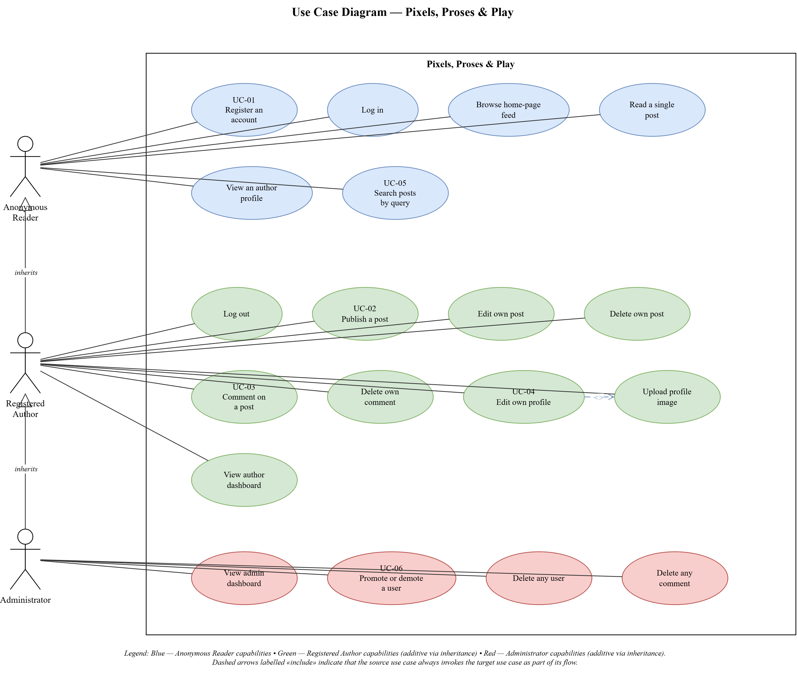

# 3. Requirement Gathering

This chapter records the requirements the Pixels, Proses & Play platform was designed to meet. The requirements are organized into five parts. Section 3.1 defines the three user roles the system recognizes and the boundary between them. Section 3.2 lists the functional requirements, grouped by capability area and tagged with the service and controller that own them. Section 3.3 lists the non-functional requirements and names the artifact in the codebase that verifies each one. Section 3.4 presents six use cases in a standard template and summarizes them as a use case diagram. Section 3.5 consolidates the feature set as a single table that cross-references roles, functional requirement identifiers, and implementation status.

The requirements were gathered iteratively. The initial list was written at project inception, before any code was committed. It was revised at the end of each refactor phase to reflect what the phase had actually produced, to retire requirements that turned out to be out of scope, and to promote tech-debt observations into non-functional requirements where they recurred. The final list, reproduced in this chapter, is the one that the submitted codebase implements.

## 3.1 User Roles

The platform recognizes three roles. A role is a named set of capabilities. Every authenticated request is executed in the context of exactly one role. Unauthenticated requests are treated as a fourth implicit role for the purpose of authorization, referred to below as Anonymous Reader. The role is carried on the Spring Security `Authentication` object and is read from the `AppUserDetails` principal; it is stored in the database on the `users.role` column as a string with a check constraint restricting its value to the two named authenticated roles.

### 3.1.1 Anonymous Reader

An Anonymous Reader is any client that has not completed a login and does not present a valid session cookie. The role covers readers who arrive at the site from a shared link, from a search engine, or from another post on the platform. An Anonymous Reader may read any published post, view the author profile attached to that post, browse posts by tag, use the search endpoint, and reach the registration and login pages. An Anonymous Reader may not publish, edit, delete, comment, or upload. The capability boundary is enforced by the Spring Security filter chain configured in `SecurityConfig`; attempts to reach a protected URL redirect the client to the login page with the original URL preserved as a `redirect` query parameter.

### 3.1.2 Registered Author

A Registered Author is an authenticated user whose row in the `users` table carries the role `ROLE_USER`. New authors are provisioned either through the public registration page or through an invitation shared by an existing author outside the system. The invitation model is deliberate. The platform does not aim to grow through open sign-up discovery, and no email verification or captcha is on the critical path. A Registered Author may publish a post, edit or delete a post they own, comment on any post, edit their own profile including display name and profile image, upload an image to attach to their profile, and view the dashboard listing their own posts. A Registered Author may not edit or delete another author's content, access the administration console, or grant or revoke roles. Authorization for owned resources is enforced at the service layer: `PostService.updatePost` and `PostService.deletePost` throw a `PostOwnershipException` when the requesting username does not match the stored author, and the controllers translate the exception into a flash-messaged redirect to the dashboard.

### 3.1.3 Administrator

An Administrator is an authenticated user whose row in the `users` table carries the role `ROLE_ADMIN`. The role is intended for the operator of the platform and for a very small number of trusted invitees. An Administrator holds every capability of a Registered Author and additionally may view the administration dashboard, delete any author's account, delete any post, and promote or demote any Registered Author to or from administrator status. The role is seeded on the production profile by the `AdminBootstrapper` component, which reads the credentials from the `ADMIN_USERNAME`, `ADMIN_EMAIL`, and `ADMIN_PASSWORD` environment variables at application startup and creates exactly one administrator if no row with the role already exists. Subsequent restarts are idempotent. Local development profiles do not seed an administrator; one is created manually through the registration page followed by a direct database update, which is acceptable for the two-user development workflow.

## 3.2 Functional Requirements

The functional requirements are grouped by capability area. Each requirement is assigned an identifier of the form `FR-<AREA>-<NN>`, where `<AREA>` is a four-letter mnemonic for the capability area and `<NN>` is a two-digit sequence number within that area. The identifier is stable; a requirement that is later retired keeps its number and the reused number is not assigned to a new requirement. Each requirement carries a one-sentence rationale and a short implementation reference to the service and controller that own it, so that the reader can follow the requirement into Chapter 6's class diagrams and Chapter 5's feature development process without ambiguity.

### 3.2.1 Authentication (AUTH)

- **FR-AUTH-01.** The system shall allow an Anonymous Reader to register as a Registered Author by supplying a username, an email address, and a password. The username and email address shall be unique within the user table. The password shall be stored only as a BCrypt hash. *Rationale:* The role boundary between Anonymous Reader and Registered Author is the single entry point to publishing, so the registration flow is the only privilege-elevation path the system offers to the public. *Owner:* `AuthController.register` delegates to `UserService.register`.
- **FR-AUTH-02.** The system shall allow a Registered Author or Administrator to authenticate by supplying their username and password. On success the system shall establish a session cookie bound to the authenticated principal. *Rationale:* The session cookie is the only state the client carries across requests; every other state is server-side. *Owner:* Spring Security form-login configured in `SecurityConfig`.
- **FR-AUTH-03.** The system shall allow an authenticated user to log out, invalidating the session on the server and clearing the session cookie on the client. *Rationale:* A log-out flow is the symmetric counterpart to log-in and prevents a session from outliving the user's intent to be authenticated. *Owner:* Spring Security logout handler.
- **FR-AUTH-04.** The system shall reject registration attempts where the username or email address is already in use, where the password is shorter than eight characters, or where any required field is blank. *Rationale:* Blank fields and weak passwords are the most common user errors and the cheapest to intercept at the form boundary. *Owner:* `RegisterRequest` constraints enforced by Jakarta Bean Validation.

### 3.2.2 Authoring (POST)

- **FR-POST-01.** The system shall allow a Registered Author to publish a new post consisting of a title, a rich-text body, and a comma-separated list of tag names. *Rationale:* Publishing a post is the core transaction of the platform; every other authoring requirement is a variation on it. *Owner:* `PostController.savePost` delegates to `PostService.createPost`.
- **FR-POST-02.** The system shall accept rich-text content from the Toast UI Editor, including headings, lists, blockquotes, inline formatting, links, and inline images encoded as base-64 data URIs. *Rationale:* The editor's output is the format the server receives; the sanitizer policy is set to pass the tags the editor emits and strip everything else. *Owner:* `HtmlSanitizer` policy defined in `HtmlSanitizer` bean configuration.
- **FR-POST-03.** The system shall strip disallowed HTML from a post's rich-text content on write, retaining only the allowlisted tags and attributes defined by the OWASP sanitizer policy. Posts shall be stored in sanitized form. *Rationale:* Rendering is the hottest path in the application and must not carry a sanitization cost per request; sanitize-on-write dominates sanitize-on-read for a read-heavy platform. *Owner:* `HtmlSanitizer.sanitize` called inside `PostService.createPost` and `PostService.updatePost`.
- **FR-POST-04.** The system shall allow a Registered Author to edit a post they own, overwriting the title, body, and tag list with the submitted values. *Rationale:* The edit path reuses the create path's validation and sanitization rules; the only additional requirement is ownership. *Owner:* `PostController.updatePost` delegates to `PostService.updatePost`.
- **FR-POST-05.** The system shall allow a Registered Author to delete a post they own. Comments attached to the post shall be cascaded. *Rationale:* A post and its comments form a single conceptual object; orphaned comments are a data quality hazard that the schema prevents by cascade. *Owner:* `PostController.deletePost` delegates to `PostService.deletePost`; cascade is declared on the `Post` entity.
- **FR-POST-06.** The system shall reject an edit or delete request for a post whose author does not match the authenticated user. The rejection shall be visible to the user as a flash-messaged redirect to the dashboard. *Rationale:* Silent redirects mask authorization failures from users who may have followed a stale link; a visible message is kinder and more diagnosable. *Owner:* `PostOwnershipException` thrown by `PostService`; caught and translated by `PostController`.
- **FR-POST-07.** The system shall reject post submissions with a blank title, with a body whose rich-text content strips to empty, or with a body longer than five million characters. *Rationale:* The five-million-character ceiling accommodates inline base-64 images at the current editor configuration; the `@NotBlankHtml` validator intercepts WYSIWYG empty shells that `@NotBlank` lets through. *Owner:* `PostForm` field constraints.

### 3.2.3 Reading (READ)

- **FR-READ-01.** The system shall present an Anonymous Reader with a home page listing the ten most recent posts in reverse chronological order, with an optional set of featured posts drawn at random from the full corpus. *Rationale:* The home page is the only route a reader lands on without context; both feeds are curated by the system rather than by the reader. *Owner:* `HomeController.home` calls `PostService.getRecentPosts` and `PostService.getFeaturedPosts`.
- **FR-READ-02.** The system shall render a single post at the URL `/post/{id}`, including its title, body, author byline, publication date, tag list, and comment thread. *Rationale:* The canonical permalink for a post is its database identifier; readable slugs are out of scope and reserved for a future slug-generation feature. *Owner:* `PostController.viewPost` calls `PostService.getPostForView`.
- **FR-READ-03.** The system shall return an HTTP 404 response with the custom not-found template when the requested post identifier does not resolve to an existing post. *Rationale:* An HTTP 500 for a missing post is a bug that the project inherited and that Phase 3's domain exceptions corrected. *Owner:* `PostNotFoundException` annotated `@ResponseStatus(NOT_FOUND)`.
- **FR-READ-04.** The system shall present a Registered Author with a dashboard listing the posts they have published, newest first. *Rationale:* The dashboard is the author's primary entry point and must not require a search; a simple list sorted by date is sufficient at the scale of a personal publication. *Owner:* `DashboardController.dashboard` calls `PostService.getPostsByUser`.
- **FR-READ-05.** The system shall list posts and their tag names on the dashboard and home page without issuing a separate database query per post. *Rationale:* The N+1 pattern turns a one-visit page view into dozens of queries and is the single most common Hibernate mistake; the fix is a fetch plan, not caching. *Owner:* `@EntityGraph(attributePaths = {"user", "tags"})` on `PostRepository.findByUser` and `PostRepository.findTop10ByOrderByCreatedAtDesc`.

### 3.2.4 Commenting (CMNT)

- **FR-CMNT-01.** The system shall allow any Registered Author or Administrator to post a comment on any published post. A comment shall consist of textual content and shall be attached to exactly one post and one author. *Rationale:* The comment thread is the platform's only reader-to-author feedback surface and is restricted to authenticated users to keep spam off the critical path. *Owner:* `CommentController.createComment` delegates to `CommentService.createComment`.
- **FR-CMNT-02.** The system shall allow a Registered Author to delete a comment they authored, and shall allow an Administrator to delete any comment. *Rationale:* The ownership model mirrors the post model; the administrator capability is a moderation requirement, not a general privilege. *Owner:* `CommentController.deleteComment` delegates to `CommentService.deleteComment`.
- **FR-CMNT-03.** The system shall reject a comment submission with blank content and shall re-render the post detail page with the submitted content and the validation error attached to the comment form. *Rationale:* The comment form shares a template with the post detail view, so a validation failure must preserve the user's typed text across a Post-Redirect-Get redirect. *Owner:* `CommentForm` constraints; `CommentController.createComment` flashes the form and binding result for the Post-Redirect-Get idiom.
- **FR-CMNT-04.** The system shall render comment author names and avatars without issuing one additional database query per comment during a post view. *Rationale:* A heavily commented post would otherwise generate one query per avatar; the fetch plan is declared on the repository method. *Owner:* `@EntityGraph(attributePaths = "user")` on `CommentRepository.findByPost`.

### 3.2.5 Media and Upload (UPLD)

- **FR-UPLD-01.** The system shall allow a Registered Author to upload an image to attach to their profile. Accepted content types shall be `image/jpeg`, `image/png`, and `image/webp`. The upload size shall be capped at ten megabytes. *Rationale:* A whitelist of content types is safer than a blacklist of extensions; the size cap is the only general defense against upload-based denial-of-service at the servlet layer. *Owner:* `StorageService.store`; Spring Boot multipart configuration in `application.properties`.
- **FR-UPLD-02.** The system shall store an uploaded file under a UUID-derived filename with an extension derived from the sanctioned content type, never from the client-supplied original filename. *Rationale:* The original filename is attacker-controlled data; using it anywhere on disk re-opens path traversal, Windows reserved-name clashes, and stored-filename XSS at once. *Owner:* `StorageService.store`.
- **FR-UPLD-03.** The system shall reject an upload whose content type is not on the whitelist, whose byte stream is empty, or whose request body is null. The rejection shall surface to the user as a flash-messaged return to the profile edit page, with the specific reason translated through the application's message bundle. *Rationale:* A diagnosable upload rejection is strictly more useful than a generic failure; the message code on `StorageException` is the translation key. *Owner:* `StorageException` instances thrown by `StorageService`; `ProfileController.saveProfile` catches and flashes.

### 3.2.6 Search (SRCH)

- **FR-SRCH-01.** The system shall expose a JSON endpoint at `/search` that accepts a query string parameter `q` and returns the list of posts whose title contains the query substring, matched case-insensitively. *Rationale:* A typeahead search is a cheap discoverability feature; the implementation is a derived-query repository method, not a dedicated search index. *Owner:* `SearchController.searchPosts` delegates to `PostService.searchByTitle`.
- **FR-SRCH-02.** The system shall render search results as a dropdown overlay on the home-page search box, each result linking to the matched post's permalink. *Rationale:* Rendering is client-side JavaScript consuming the JSON endpoint; the server contract is independent of the UI shell and can be reused if the UI is swapped. *Owner:* Client-side JavaScript on the home page.

### 3.2.7 Profile (PROF)

- **FR-PROF-01.** The system shall allow a Registered Author to view their own profile at `/profile/{username}` and shall allow any user, including an Anonymous Reader, to view any author's profile. *Rationale:* Author profiles are public; the role boundary applies to editing, not viewing. *Owner:* `ProfileController.profile` delegates to `UserService.findByUsername`.
- **FR-PROF-02.** The system shall allow a Registered Author to edit their display name, biography, and profile image, with the image handled through `FR-UPLD-01`. *Rationale:* The profile edit page is the only surface where a user writes to their own `users` row, which keeps the attack surface small. *Owner:* `ProfileController.saveProfile` delegates to `UserService.updateProfile`.
- **FR-PROF-03.** The system shall reject a profile edit submission with a biography longer than five hundred characters or with any required field left blank. *Rationale:* The biography length ceiling is a template-layout constraint, not a storage constraint; the validation runs server-side regardless. *Owner:* `ProfileForm` constraints.

### 3.2.8 Administration (ADMN)

- **FR-ADMN-01.** The system shall expose an administration dashboard at `/admin` that lists every user and every post, visible only to an Administrator. *Rationale:* The administration dashboard is the operator's view of the system and is behind a role check that the servlet container enforces before the handler runs. *Owner:* `AdminController.adminDashboard` delegates to `AdminService.getAllUsers` and `AdminService.getAllPosts`; Spring Security URL pattern `/admin/**` requires `ROLE_ADMIN`.
- **FR-ADMN-02.** The system shall allow an Administrator to delete any user. Deleting a user shall cascade to that user's posts and comments. *Rationale:* A user and their content form the account; deletion is the symmetric inverse of registration and must leave no dangling references. *Owner:* `AdminController.deleteUser` delegates to `AdminService.deleteUser`.
- **FR-ADMN-03.** The system shall allow an Administrator to promote any Registered Author to Administrator, or to demote any Administrator to Registered Author. *Rationale:* Role transitions are the only way an authenticated user's capabilities change; they are deliberately restricted to Administrators and are logged. *Owner:* `AdminController.toggleUserRole` delegates to `AdminService.toggleUserRole`.
- **FR-ADMN-04.** The system shall seed exactly one Administrator on the production profile at application startup, reading the credentials from environment variables, and shall not seed any further administrators automatically. *Rationale:* An administrator provisioned by a migration is tied to the code; an administrator provisioned by environment is tied to the deployment, which is the correct granularity. *Owner:* `AdminBootstrapper`.

## 3.3 Non-Functional Requirements

The non-functional requirements describe the quality attributes the system is expected to exhibit. Each requirement is paired with a verification artifact: the Phase of the refactor that landed it, the automated test that guards it, the production configuration property that enforces it, or the operational metric that measures it. A non-functional requirement without a verification artifact is treated as aspirational and is not claimed as satisfied.

### 3.3.1 Security (SEC)

- **NFR-SEC-01.** The system shall store passwords only as BCrypt hashes with the Spring Security default work factor. *Verified by:* `AuthControllerTest.register_persistsUserWithEncodedPassword`.
- **NFR-SEC-02.** The system shall refuse to deserialize unknown form fields into domain entities, structurally preventing mass assignment. *Verified by:* The form DTOs `RegisterRequest`, `PostForm`, `ProfileForm`, and `CommentForm`, each exposing only the fields its audience is allowed to write; Phase 4 of the refactor.
- **NFR-SEC-03.** The system shall sanitize all rich-text content against an OWASP allowlist policy before persisting it. *Verified by:* `PostServiceTest.createPost_storesSanitizedContentNotRawInput` and the suite of `HtmlSanitizerTest` cases.
- **NFR-SEC-04.** The system shall accept only whitelisted content types on image upload and shall derive the on-disk extension from the content type, never from the client-supplied filename. *Verified by:* `StorageServiceTest.store_rejectsUnsupportedContentType` and `StorageServiceTest.store_writesFileAndReturnsUuidNameWithExtensionDerivedFromContentType`.
- **NFR-SEC-05.** The system shall serve all production traffic over TLS. *Verified by:* Render's managed TLS on the `onrender.com` domain; HTTP requests to the application host are redirected to HTTPS by the Render edge.
- **NFR-SEC-06.** The system shall not expose debug or introspection endpoints to anonymous clients in production. *Verified by:* `management.endpoints.web.exposure.include=health` in `application-postgres.properties`; the removal of the `/whoami` endpoint in Phase 6.

### 3.3.2 Portability (POR)

- **NFR-POR-01.** The system shall be deployable against H2, MySQL, and PostgreSQL without code change. *Verified by:* The three parallel `V1__init.sql` migrations under `db/migration/h2`, `db/migration/mysql`, and `db/migration/postgresql`, selected at startup by Flyway's `{vendor}` placeholder.
- **NFR-POR-02.** The system shall contain no database-vendor-specific SQL in application code. *Verified by:* The removal of the native MySQL query `findRandomPosts` in Phase 5, replaced by `PostService.getFeaturedPosts` using `findAllIds` plus `Collections.shuffle` plus `findAllById`.
- **NFR-POR-03.** The system shall be deployable to any container-orchestration platform that accepts an OCI image. *Verified by:* The `Dockerfile` at the repository root, independently buildable with `docker build` and runnable with `docker run`.

### 3.3.3 Maintainability (MNT)

- **NFR-MNT-01.** The system shall use constructor injection throughout, with no field-level `@Autowired` in production code. *Verified by:* Code review of the final state of the refactor; a search for `@Autowired` in `src/main/java` returns no results.
- **NFR-MNT-02.** The system shall separate view models from persistence entities on every list-rendering endpoint. *Verified by:* `PostSummaryDto` and `PostSummaryMapper`; `DataCorruptionBugTest.visitingHomePage_mustNotMutatePostContent`.
- **NFR-MNT-03.** The system shall own its database schema as versioned SQL under source control. *Verified by:* `spring.jpa.hibernate.ddl-auto=validate` and the Flyway migration history.
- **NFR-MNT-04.** The system shall carry a passing automated test suite that includes unit, slice, and full-context tests in the ratio of a testing pyramid. *Verified by:* Forty-three passing tests at the time of submission, distributed across `@ExtendWith(MockitoExtension.class)` unit tests, `@WebMvcTest` and `@DataJpaTest` slice tests, and a small number of `@SpringBootTest` smoke tests.
- **NFR-MNT-05.** The system shall externalize user-facing strings into a resource bundle to keep copy out of code. *Verified by:* `messages.properties` consumed through `FlashService` and Spring's `MessageSource`.

### 3.3.4 Performance (PRF)

- **NFR-PRF-01.** The system shall render the home page and the author dashboard in a bounded, constant number of database queries irrespective of the number of posts rendered. *Verified by:* The `@EntityGraph` fetch plans on `PostRepository.findByUser`, `PostRepository.findTop10ByOrderByCreatedAtDesc`, and `PostRepository.findAllById`; a Hibernate SQL log inspection on a seeded dataset.
- **NFR-PRF-02.** The system shall maintain a database connection pool sized to the free-tier runtime budget of five hundred and twelve megabytes of memory. *Verified by:* `spring.datasource.hikari.maximum-pool-size=5`, `minimum-idle=0`, `idle-timeout=240000` in `application-postgres.properties`.
- **NFR-PRF-03.** The system shall start up and bind to its HTTP port within sixty seconds on a cold start of the free-tier runtime. *Verified by:* Observation of Render's build and run logs across deploys; the container-aware JVM sizing `-XX:MaxRAMPercentage=75.0` in the Dockerfile.
- **NFR-PRF-04.** The system shall accept SIGTERM and drain in-flight requests before terminating. *Verified by:* `server.shutdown=graceful` and `spring.lifecycle.timeout-per-shutdown-phase=25s` in `application-postgres.properties`.

### 3.3.5 Usability (USE)

- **NFR-USE-01.** The system shall surface validation failures inline on the form that produced them, with the user's submitted values preserved. *Verified by:* `BindingResult` handling on every `@Valid @ModelAttribute` endpoint; the Post-Redirect-Get idiom on the comment form.
- **NFR-USE-02.** The system shall render identically well in light and dark color schemes with no additional user action. *Verified by:* The CSS custom-property design system in `theme.css`, with the three token blocks on `:root`, `:root:not([data-theme="light"])` under `@media (prefers-color-scheme: dark)`, and `:root[data-theme="dark"]`.
- **NFR-USE-03.** The system shall convey state transitions, successes, and failures through toast-styled flash messages with semantic color variants. *Verified by:* `FlashMessage` record, `FlashType` enum, and the `fragments/flash.html` Bootstrap toast fragment.
- **NFR-USE-04.** The system shall preserve a user's typed input across a redirect-after-post flow without a second round trip to the server. *Verified by:* `RedirectAttributes.addFlashAttribute` with the `org.springframework.validation.BindingResult.<attr>` key on the comment form path.

### 3.3.6 Observability (OBS)

- **NFR-OBS-01.** The system shall expose a liveness and readiness endpoint reachable by anonymous clients. *Verified by:* `management.endpoints.web.exposure.include=health`; the Spring Security permit-all rule on `/actuator/health`.
- **NFR-OBS-02.** The system shall be monitored by an external uptime prober that pings the health endpoint at an interval shorter than the free-tier spin-down threshold. *Verified by:* The UptimeRobot monitor configured against `/actuator/health` at a five-minute interval, against Render's fifteen-minute spin-down threshold.
- **NFR-OBS-03.** The system shall log through SLF4J, with no raw `System.out.println` or `Throwable.printStackTrace` calls in production code. *Verified by:* Phase 6 hygiene pass; a repository search for the disallowed patterns returns no results.

## 3.4 Use Cases

This section presents six use cases drawn from the functional requirements of Section 3.2. The use cases are the scenarios that most clearly exercise the role boundaries, the validation seams, and the cross-service transactions. Each use case is given in a fixed template: identifier, name, primary actor, preconditions, main flow, alternate flows, postconditions, and the functional requirements the scenario touches. Figure 3.1 presents the use case diagram, with the three roles as actors on the outside of the system boundary and the use cases as ovals within the boundary.

### 3.4.1 UC-01: Register an Account

- **Primary actor:** Anonymous Reader.
- **Preconditions:** No active session cookie is presented.
- **Main flow:**
  1. The actor navigates to `/register`.
  2. The system presents the registration form with fields for username, email address, and password.
  3. The actor fills the form and submits it.
  4. The system validates that no required field is blank, the password is at least eight characters, and the username and email address are both unused.
  5. The system creates a `User` row with role `ROLE_USER` and the password stored as a BCrypt hash.
  6. The system redirects the actor to the login page with a flash message confirming successful registration.
- **Alternate flows:**
  1. **A1 Invalid input:** If any constraint in step 4 fails, the system re-renders the registration form with the actor's submitted values and per-field error messages. The flow returns to step 3.
  2. **A2 Duplicate username or email:** If step 4 detects an existing user, the system attaches a form-level error and re-renders the form. The flow returns to step 3.
- **Postconditions:** On the main flow, the `users` table contains one new row with the submitted username and email; the password column holds a BCrypt hash of the submitted password.
- **Related FRs:** FR-AUTH-01, FR-AUTH-04.

### 3.4.2 UC-02: Publish a Post

- **Primary actor:** Registered Author.
- **Preconditions:** The actor holds a valid session cookie bound to a `ROLE_USER` principal.
- **Main flow:**
  1. The actor navigates to `/post/create`.
  2. The system presents the authoring form, including a Toast UI Editor instance for the post body and a text input for a comma-separated tag list.
  3. The actor composes the post, adds tags, and submits.
  4. The system validates that the title is not blank, that the editor's HTML content is non-empty after tag stripping, and that the body length is at most five million characters.
  5. The system sanitizes the submitted HTML through the OWASP allowlist policy.
  6. The system resolves each submitted tag name: an existing tag is reused, a new tag is created.
  7. The system persists the `Post` row with the sanitized HTML, the author reference, and the resolved tag set, within a single transaction.
  8. The system redirects the actor to the dashboard with a flash message confirming publication.
- **Alternate flows:**
  1. **A1 Validation failure:** If step 4 fails, the system re-renders the authoring form with the actor's submitted values and error messages attached to the failing fields. The flow returns to step 3.
  2. **A2 Tag resolution race:** If a concurrent transaction has inserted a tag of the same name, the unique constraint on `tags.name` causes a rollback of step 6; the surrounding transaction retries the lookup on the retry and proceeds.
- **Postconditions:** On the main flow, the `posts` table contains one new row; the `post_tags` join table contains one row per submitted tag; new tag names appear in the `tag` table.
- **Related FRs:** FR-POST-01, FR-POST-02, FR-POST-03, FR-POST-07.

### 3.4.3 UC-03: Comment on a Post

- **Primary actor:** Registered Author or Administrator.
- **Preconditions:** The actor holds a valid session cookie; the target post exists.
- **Main flow:**
  1. The actor navigates to `/post/{id}` for a post that exists.
  2. The system renders the post, its comment thread, and a comment form below the thread.
  3. The actor types a comment and submits.
  4. The system validates that the comment is not blank.
  5. The system persists the `Comment` row with the actor as author and the target post as parent.
  6. The system redirects to `/post/{id}` with a flash message confirming the comment.
- **Alternate flows:**
  1. **A1 Blank comment:** If step 4 fails, the system flashes the submitted form and the `BindingResult` to the post detail page and redirects. The GET handler for the post detail page reads the flashed form, renders the comment form with the invalid value preserved and the error inline.
  2. **A2 Deleted post:** If the post has been deleted between the actor loading the page and submitting the comment, step 5 throws a `PostNotFoundException` and the system responds with a 404.
- **Postconditions:** On the main flow, the `comments` table contains one new row linked to the target post and the actor.
- **Related FRs:** FR-CMNT-01, FR-CMNT-03.

### 3.4.4 UC-04: Edit Own Profile

- **Primary actor:** Registered Author.
- **Preconditions:** The actor holds a valid session cookie.
- **Main flow:**
  1. The actor navigates to `/profile/edit`.
  2. The system presents the profile edit form with the actor's current display name, biography, and profile image.
  3. The actor modifies one or more fields and, optionally, attaches a new image file.
  4. The system validates that the biography is at most five hundred characters and that no required field is blank.
  5. If a file was attached, the system passes it to `StorageService.store`, which validates the content type and size, writes it under a UUID name, and returns the public URL.
  6. The system updates the actor's `users` row with the submitted values and the stored image URL.
  7. The system redirects to the actor's profile page with a flash message confirming the update.
- **Alternate flows:**
  1. **A1 Validation failure:** If step 4 fails, the system re-renders the form with the actor's submitted values and inline errors.
  2. **A2 Rejected upload:** If step 5 throws `StorageException`, the system reads the exception's `messageCode`, translates it through `MessageSource`, flashes the translated message, and redirects back to the edit form.
- **Postconditions:** On the main flow, the actor's `users` row reflects the submitted values; a new file exists on disk if an image was attached.
- **Related FRs:** FR-PROF-02, FR-UPLD-01, FR-UPLD-02, FR-UPLD-03.

### 3.4.5 UC-05: Search Posts by Query

- **Primary actor:** Anonymous Reader, Registered Author, or Administrator.
- **Preconditions:** None.
- **Main flow:**
  1. The actor types in the search box on the home page.
  2. After each keystroke, the client-side JavaScript issues a GET to `/search?q={query}`.
  3. The system queries the posts table for rows whose title contains the query substring, matched case-insensitively; the matches are returned as a JSON list of `PostSearchResultDto` records.
  4. The client renders the results as a dropdown below the search box; each result is a link to the matched post's permalink.
  5. The actor clicks a result; the browser navigates to the post's detail page.
- **Alternate flows:**
  1. **A1 Empty query:** If the query is empty or shorter than two characters, the client does not call the endpoint and clears the dropdown.
  2. **A2 No matches:** If the server returns an empty array, the client renders an empty-state line below the search box.
- **Postconditions:** No persistent state changes.
- **Related FRs:** FR-SRCH-01, FR-SRCH-02.

### 3.4.6 UC-06: Administrator Demotes an Author

- **Primary actor:** Administrator.
- **Preconditions:** The actor holds a valid session cookie bound to a `ROLE_ADMIN` principal; the target user is a Registered Author or Administrator.
- **Main flow:**
  1. The actor navigates to `/admin`.
  2. The system renders the administration dashboard, listing all users with their current roles and a role-toggle control next to each row.
  3. The actor clicks the role-toggle control for the target user.
  4. The system flips the `users.role` column for the target between `ROLE_USER` and `ROLE_ADMIN`.
  5. The system redirects to `/admin` with a flash message reporting the new role.
- **Alternate flows:**
  1. **A1 Target does not exist:** If step 4 cannot find the target user, the system responds with a 404.
  2. **A2 Target is the acting administrator:** The system still permits the self-demotion; the session continues to be valid under the new role, but subsequent `/admin` requests are redirected to the login page by the filter chain.
- **Postconditions:** On the main flow, the target user's `users.role` column holds the flipped value.
- **Related FRs:** FR-ADMN-01, FR-ADMN-03.

### 3.4.7 Use Case Diagram

Figure 3.1 presents the use case diagram. The three actors stand outside the system boundary. An authenticated actor inherits every use case an anonymous actor can execute, which the diagram represents through an include relationship on the inheritance arrows. The Administrator actor inherits the Registered Author's use cases through the same mechanism. Use cases that extend another use case through an alternate flow are drawn with an extend relationship.

*Figure 3.1: Use case diagram for the Pixels, Proses & Play platform.*

## 3.5 Feature Set

Table 3.01 consolidates the functional requirements of Section 3.2 into a single feature-set view. Each row is one feature. The columns record which roles can exercise the feature, the primary functional requirement that defines it, and the implementation status at the time of submission. All features listed as implemented are exercised by one or more automated tests, by the cross-vendor smoke script, or by the live deployment at the project URL.

**Table 3.01: Feature set of the Pixels, Proses & Play platform.**

| Feature | Anonymous Reader | Registered Author | Administrator | Primary FR | Status |
|--------|:---:|:---:|:---:|---|---|
| Register an account | Yes | — | — | FR-AUTH-01 | Implemented |
| Log in | Yes | — | — | FR-AUTH-02 | Implemented |
| Log out | — | Yes | Yes | FR-AUTH-03 | Implemented |
| Browse the home-page post feed | Yes | Yes | Yes | FR-READ-01 | Implemented |
| Read a single post | Yes | Yes | Yes | FR-READ-02 | Implemented |
| View an author profile | Yes | Yes | Yes | FR-PROF-01 | Implemented |
| Search posts by query | Yes | Yes | Yes | FR-SRCH-01 | Implemented |
| Publish a post | — | Yes | Yes | FR-POST-01 | Implemented |
| Edit an owned post | — | Yes | Yes | FR-POST-04 | Implemented |
| Delete an owned post | — | Yes | Yes | FR-POST-05 | Implemented |
| Post a comment | — | Yes | Yes | FR-CMNT-01 | Implemented |
| Delete an owned comment | — | Yes | Yes | FR-CMNT-02 | Implemented |
| View the author dashboard | — | Yes | Yes | FR-READ-04 | Implemented |
| Edit own profile | — | Yes | Yes | FR-PROF-02 | Implemented |
| Upload a profile image | — | Yes | Yes | FR-UPLD-01 | Implemented |
| View the admin dashboard | — | — | Yes | FR-ADMN-01 | Implemented |
| Delete any user | — | — | Yes | FR-ADMN-02 | Implemented |
| Delete any comment | — | — | Yes | FR-CMNT-02 | Implemented |
| Promote or demote a user | — | — | Yes | FR-ADMN-03 | Implemented |
| Inline-image upload endpoint | — | — | — | (future) | Deferred |
| Slug-based post permalinks | — | — | — | (future) | Deferred |
| Email verification on sign-up | — | — | — | (future) | Deferred |

The deferred rows are tracked as tech debt in the project's living design document and are revisited after submission.
