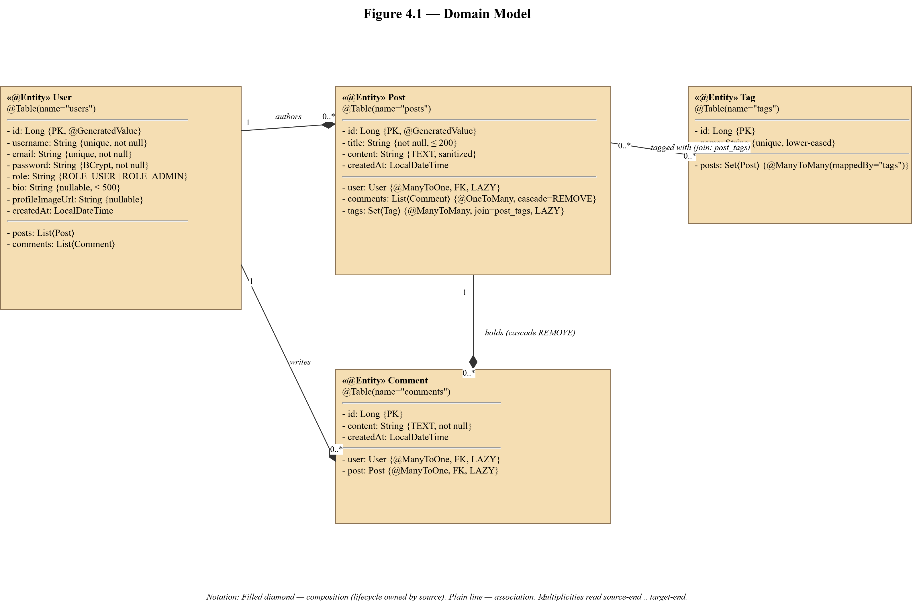
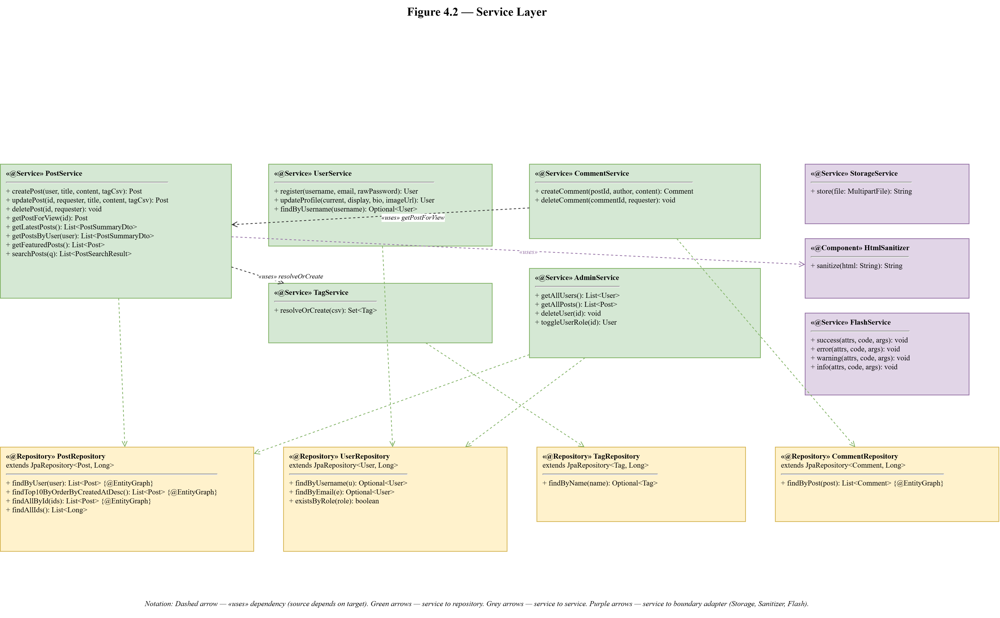
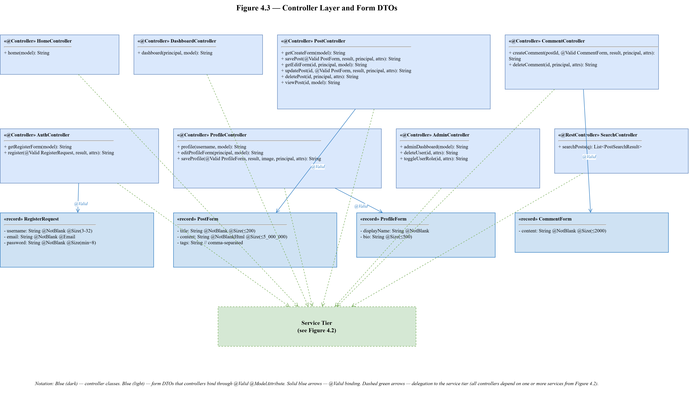

# 4. Class Diagrams

This chapter presents the low-level design of the Pixels, Proses & Play platform through a set of class diagrams and their accompanying textual descriptions. The chapter is organized by architectural tier, with one figure per tier and one subsection that walks the reader through the classes the figure contains, the relationships between them, and the design decisions that produced the resulting shape. Section 4.1 states the conventions used across the chapter. Section 4.2 presents the domain model, which holds the JPA entities and their relationships. Section 4.3 presents the service layer, which holds the business-rule classes and their dependencies on the repository layer. Section 4.4 presents the controller layer and the form data transfer objects it binds to. Section 4.5 covers the supporting abstractions that cut across the three tiers: the domain exceptions, the validation constraints, the DTO mappers, and the boundary adapters.

## 4.1 Approach and Conventions

The class diagrams in this chapter follow the Unified Modeling Language class-diagram notation with three concessions to practicality. First, Lombok-generated accessors are not drawn; a Lombok `@Getter`/`@Setter` pair on an entity is understood to generate the corresponding `getFoo` and `setFoo` methods and the diagrams omit them to keep the entity rectangles readable. Second, Spring stereotypes are shown as class-level annotations (`«@Service»`, `«@Repository»`, `«@Controller»`) rather than as separate decorator classes; the stereotype carries the meaning the reader needs. Third, generic parameters on Spring Data repositories are reduced to the entity type and the identifier type as the only two type arguments, with the inherited `JpaRepository` methods suppressed; declared methods are shown in full.

The figures use a consistent colour palette across the chapter. Domain entities are shaded in a warm beige, services in a muted green, repositories in a soft yellow, controllers in a blue, data transfer objects in a lighter blue, and cross-cutting abstractions in violet. The palette matches the one used in Figure 2.1 and is applied so that a reader can trace a dependency through all three figures without losing the tier of a given class.

The relationships drawn in the figures are UML associations, aggregations, and compositions, with multiplicities labelled at each end. Lines with filled diamonds indicate composition, where the owning class is responsible for the lifecycle of the owned object; lines with open diamonds indicate aggregation, where the relationship exists but the lifecycles are independent; plain lines indicate association. Dashed arrows indicate dependency in the direction of the arrow. Generalization (class extension) is drawn with an open triangular arrowhead.

The conventions above are applied uniformly. Where a class appears in more than one figure, it carries the same name and the same colour; its methods may be abbreviated in one figure to foreground a different relationship, but the class is the same class.

## 4.2 Domain Model

The domain model consists of four JPA entities: `User`, `Post`, `Comment`, and `Tag`. Each entity is mapped to a single database table under the Hibernate 6 ORM, with the schema owned by versioned Flyway migrations. The entities are drawn in Figure 4.1.

*Figure 4.1: Domain model class diagram.*

### 4.2.1 User

The `User` class represents an authenticated account on the platform. The class is annotated with `@Entity` and `@Table(name = "users")`; the table name is explicit to avoid a reserved-word clash on PostgreSQL. The identifier field `id` is a `Long` generated by the database's identity column. The `username`, `email`, and `password` fields are mandatory and the first two carry unique constraints enforced at the schema level. The `role` field is stored as a string with a check constraint restricting the value to `ROLE_USER` or `ROLE_ADMIN`. The `bio` field is a nullable text column capped at five hundred characters by the form validator. The `profileImageUrl` field is a nullable string holding the URL path to the uploaded image, written by the `StorageService`. The `createdAt` timestamp is set on insert and never updated.

`User` carries two bidirectional one-to-many relationships. A user owns zero or more posts through the `posts` collection, mapped by the `user` field on `Post`; the relationship is lazily fetched and cascades removals, so deleting a user cascades to that user's posts. A user authors zero or more comments through the `comments` collection, mapped by the `user` field on `Comment`; the same cascade applies.

### 4.2.2 Post

The `Post` class represents a published post. The class is annotated with `@Entity` and maps to the `posts` table. The identifier field `id` is a `Long` generated by the identity column. The `title` field is mandatory and capped at two hundred characters. The `content` field holds the sanitized HTML body and is mapped as a `TEXT` column across all three supported vendors (the field was originally annotated `@Lob` but the annotation produced a `pg_largeobject` mapping on PostgreSQL rather than the intended `TEXT` column, so the annotation was removed and replaced by `@Column(columnDefinition = "TEXT")`). The `createdAt` timestamp is set on insert.

`Post` carries three relationships. A many-to-one association to `User` through the `user` field represents the author; the relationship is lazily fetched. A one-to-many composition to `Comment` through the `comments` collection represents the comment thread; comments are cascaded on removal. A many-to-many association to `Tag` through the `post_tags` join table represents the post's tags; the relationship is lazily fetched and the tag set is loaded eagerly only when a repository method declares the appropriate `@EntityGraph` fetch plan.

### 4.2.3 Comment

The `Comment` class represents a comment on a post. The class is annotated with `@Entity` and maps to the `comments` table; as with `User`, the plural table name is explicit to avoid a reserved-word clash on PostgreSQL. The identifier field `id` is a `Long` generated by the identity column. The `content` field holds the comment text as a `TEXT` column. The `createdAt` timestamp is set on insert. The class carries two many-to-one associations: to `User` through the `user` field for the comment author, and to `Post` through the `post` field for the parent post. Both associations are lazily fetched.

### 4.2.4 Tag

The `Tag` class represents a topical tag that can be attached to posts. The class is annotated with `@Entity` and maps to the `tags` table. The identifier field `id` is a `Long` generated by the identity column. The `name` field is mandatory, unique, and stored lower-cased by the `TagService` before persist to collapse case variants into a single tag. The class carries the inverse side of the many-to-many relationship with `Post` through the `posts` collection. Tags have no cascade behavior; a deleted tag is removed from the join table but does not affect its posts.

### 4.2.5 Cardinalities

The domain model's cardinalities are summarized as follows. A user has zero or more posts; each post has exactly one author. A user has zero or more comments; each comment has exactly one author. A post has zero or more comments; each comment has exactly one parent post. A post has zero or more tags; each tag is attached to zero or more posts. The last relationship is the only many-to-many on the model and is the reason the `post_tags` join table exists; the other three are expressed directly on the foreign-key columns of the dependent tables.

## 4.3 Service Layer

The service layer holds the business rules of the platform. Each service is a Spring-managed singleton annotated `@Service`, with its dependencies injected through a package-private constructor generated by Lombok's `@RequiredArgsConstructor`. Services talk to repositories for data access and to one another for cross-aggregate operations. Services accept primitive parameters at their public method boundary and return either the JPA entity (for view) or a DTO projection (for list rendering); the controller layer is responsible for assembling primitives from form DTOs before calling a service. Services are drawn in Figure 4.2.

*Figure 4.2: Service layer class diagram.*

### 4.3.1 PostService

`PostService` is the largest service and owns every write path that touches a `Post`. Its `createPost(user, title, content, tagCsv)` method sanitizes the content through `HtmlSanitizer`, resolves the tag list through `TagService.resolveOrCreate`, and persists the post within a single Spring-managed transaction. Its `updatePost(postId, requester, title, content, tagCsv)` method loads the post, verifies that the requester's username matches the author's, throws `PostOwnershipException` if not, and otherwise overwrites the fields and tag set. `deletePost(postId, requester)` applies the same ownership check before deletion. The read paths `getPostForView(id)`, `getLatestPosts()`, `getPostsByUser(user)`, `getFeaturedPosts()`, and `searchPosts(query)` return either a single entity, a list of entities, or a list of DTOs depending on the view that will render them. `getFeaturedPosts()` implements its random selection in Java (`findAllIds` plus `Collections.shuffle` plus `findAllById`) rather than through a dialect-specific SQL expression.

### 4.3.2 TagService

`TagService` owns tag resolution. Its single public method `resolveOrCreate(csv)` takes a comma-separated string, splits it on commas, trims whitespace, lower-cases each token, de-duplicates the tokens, and for each token either returns the existing `Tag` row or creates and returns a new one. Blank input returns an empty set. The method is `@Transactional` with the default propagation of `REQUIRED`, so it joins the enclosing `PostService.createPost` or `PostService.updatePost` transaction and tag inserts commit atomically with the post.

### 4.3.3 CommentService

`CommentService` owns the comment lifecycle. Its `createComment(postId, author, content)` method delegates the post lookup to `PostService.getPostForView` so that a missing post surfaces as the same `PostNotFoundException` that drives the HTTP 404 elsewhere. Its `deleteComment(commentId, requester)` method applies an ownership check and throws `CommentOwnershipException` with the parent `postId` in the exception's payload so that the controller can redirect to the post without a second database lookup. An administrator's delete path bypasses the ownership check and is handled through `AdminService`.

### 4.3.4 UserService

`UserService` owns the user-privileged account operations. Its `register(username, email, rawPassword)` method encodes the password through the Spring-provided `PasswordEncoder` before inserting the row; the controller never sees the encoded form. Its `updateProfile(currentUsername, displayName, bio, profileImageUrl)` method loads the user, applies the field updates, and persists. Both methods accept primitives and defend against mass assignment by construction. The `findByUsername(username)` read returns an `Optional<User>` because a URL path may name a user that does not exist; the write-side methods throw `UserNotFoundException` instead because an authenticated caller is expected to exist and a miss indicates data corruption.

### 4.3.5 AdminService

`AdminService` owns the role-privileged operations. The service exposes `getAllUsers()`, `getAllPosts()`, `deleteUser(id)`, and `toggleUserRole(id)`; the first two power the administration dashboard, and the second two are destructive operations whose authorization is enforced by the Spring Security URL pattern on `/admin/**` before the handler runs. Keeping these operations out of `UserService` draws a clear boundary between operations a user can perform on themselves and operations an administrator can perform on any user.

### 4.3.6 StorageService

`StorageService` is the boundary adapter for filesystem I/O. Its `store(MultipartFile file)` method rejects a null file, an empty file, and a file whose content type is not on the whitelist (`image/jpeg`, `image/png`, `image/webp`), each with a distinct `StorageException` whose `messageCode` field drives the user-facing flash message. On acceptance, the service writes the bytes to disk under a UUID-generated filename with an extension derived from the sanctioned content type, and returns the resulting public URL. The controller never touches `java.nio.file.*`; the dependency on the underlying filesystem is confined to this class, and the current local-disk adapter can be replaced with an S3 or blob-store adapter without any change to the controller or service callers.

### 4.3.7 HtmlSanitizer

`HtmlSanitizer` is the boundary adapter for stored-XSS defense. The class holds a single `PolicyFactory` instance composed from the OWASP Java HTML Sanitizer's `Sanitizers.FORMATTING`, `BLOCKS`, `LINKS`, `IMAGES`, and `STYLES` policies. Its `sanitize(html)` method applies the policy to the input and returns an allowlisted HTML string. The service is called inside `PostService.createPost` and `PostService.updatePost` so that the database only ever holds sanitized content; the templates render the content directly through Thymeleaf's `th:utext` without a runtime sanitization step.

### 4.3.8 FlashService

`FlashService` is the boundary adapter for user-facing feedback. Its methods `success(attrs, code, args)`, `error(attrs, code, args)`, `warning(attrs, code, args)`, and `info(attrs, code, args)` accept a `RedirectAttributes` instance, a message code, and optional arguments; they translate the code through Spring's `MessageSource` for the current locale and attach a `FlashMessage` record (text plus `FlashType` enum) to the attributes under the conventional `flashMessage` key. The controller layer calls `flash.success(attrs, "post.created")` instead of hard-coding English copy; the `flash.html` Thymeleaf fragment reads the record and chooses the Bootstrap toast variant from the enum.

## 4.4 Controller Layer and Form DTOs

The controller layer handles HTTP binding, delegates business operations to services, and selects the view template to render. Each controller is a Spring-managed singleton annotated `@Controller`, with its dependencies injected through a package-private constructor generated by Lombok's `@RequiredArgsConstructor`. The field-level `@Autowired` pattern is not used anywhere in production code. Controllers bind form submissions against form DTOs declared as Java records in the `com.project.blog.dto` package; the records carry Jakarta Bean Validation constraints and are populated by Spring's `@ModelAttribute` resolver. Controllers and their form DTOs are drawn in Figure 4.3.

*Figure 4.3: Controller layer class diagram.*

### 4.4.1 HomeController and DashboardController

`HomeController.home(Model model)` renders the public home page by assembling a list of `PostSummaryDto` instances through `PostService.getLatestPosts` and `PostService.getFeaturedPosts`. `DashboardController.dashboard(AppUserDetails principal, Model model)` renders the authenticated author dashboard by projecting the author's posts through the same DTO. Both controllers are strict projections to a DTO on the way to the template, which is the pattern that closed the Phase 2 data-corruption bug.

### 4.4.2 PostController

`PostController` owns the post lifecycle at the HTTP layer. `getCreateForm(Model)` seeds an empty `PostForm` and renders the authoring template. `savePost(@Valid @ModelAttribute PostForm form, BindingResult result, AppUserDetails principal, RedirectAttributes attrs)` validates the submission, calls `PostService.createPost` with the form's primitives, and redirects to the dashboard with a flash message on success. `getEditForm(@PathVariable Long id, AppUserDetails principal, Model model)` loads the post, pre-fills a `PostForm` from its current state, and renders the edit template. `updatePost(@PathVariable Long id, @Valid @ModelAttribute PostForm form, BindingResult result, AppUserDetails principal, RedirectAttributes attrs)` validates the submission, calls `PostService.updatePost`, and catches `PostOwnershipException` to redirect with an ownership-rejection flash message. `deletePost(@PathVariable Long id, AppUserDetails principal, RedirectAttributes attrs)` applies the symmetric authorization. `viewPost(@PathVariable Long id, Model model)` loads a single post and its comments for rendering; the method returns a view name rather than a DTO because the single-post view is the one surface in the application where the controller returns a JPA entity to the template.

### 4.4.3 CommentController

`CommentController.createComment(@PathVariable Long postId, @Valid @ModelAttribute CommentForm form, BindingResult result, AppUserDetails principal, RedirectAttributes attrs)` validates the comment, delegates persistence to `CommentService.createComment`, and redirects back to the post. On validation failure the controller flashes the submitted form and the `BindingResult` to the redirect so that the post detail view's GET handler reads them back and re-renders the comment form with the user's input intact. This is the Post-Redirect-Get idiom applied to a form that shares a template with a different controller's GET.

### 4.4.4 AuthController

`AuthController` handles registration. `getRegisterForm(Model)` seeds a `RegisterRequest`; `register(@Valid @ModelAttribute RegisterRequest form, BindingResult result, RedirectAttributes attrs)` validates, delegates to `UserService.register`, and redirects to the login page on success. Login is handled by Spring Security's form-login filter configured in `SecurityConfig`; `AuthController` does not own the `/login` endpoint, only the `/register` endpoint and the pages that surround it.

### 4.4.5 ProfileController

`ProfileController.profile(@PathVariable String username, Model model)` renders a public author profile. `editProfileForm(AppUserDetails principal, Model model)` seeds a `ProfileForm` from the authenticated user's current state. `saveProfile(@Valid @ModelAttribute ProfileForm form, BindingResult result, @RequestParam(required=false) MultipartFile image, AppUserDetails principal, RedirectAttributes attrs)` validates the form, delegates the optional upload to `StorageService.store`, catches `StorageException` to translate the exception's `messageCode` into a user-facing flash message, and delegates the user update to `UserService.updateProfile`.

### 4.4.6 AdminController

`AdminController.adminDashboard(Model model)` renders the administration dashboard. `deleteUser(@PathVariable Long id, RedirectAttributes attrs)` and `toggleUserRole(@PathVariable Long id, RedirectAttributes attrs)` apply the destructive operations through `AdminService`. Authorization is enforced by the Spring Security URL pattern `/admin/**` requiring `ROLE_ADMIN` before the handler runs, so the controller methods are free of authorization code.

### 4.4.7 SearchController

`SearchController.searchPosts(@RequestParam String q)` is the only `@RestController` on the platform. It returns a JSON list of `PostSearchResult` DTOs for consumption by the client-side typeahead on the home page.

### 4.4.8 Form DTOs

The form DTOs are four Java records: `RegisterRequest`, `PostForm`, `ProfileForm`, and `CommentForm`. Each record exposes only the fields its audience is allowed to write, and each field carries the Jakarta Bean Validation constraints that enforce its input contract. `RegisterRequest` holds `username`, `email`, and `password`. `PostForm` holds `title`, `content`, and `tags`; the `content` field carries the custom `@NotBlankHtml` constraint so that WYSIWYG empty shells are rejected. `ProfileForm` holds `displayName` and `bio`; the profile image is handled through a separate `MultipartFile` parameter on the controller method, not through the form DTO. `CommentForm` holds `content`. None of the records expose an `id` field or a role field; the identifier for an edit is always read from the URL path, and the authenticated user is always read from the session principal, which structurally prevents the mass-assignment attack that Phase 3 closed at the service seam and Phase 4 closed at the binding target.

## 4.5 Supporting Abstractions

Three groups of classes cut across the three tiers: the domain exception hierarchy, the validation constraints, and the DTO mappers.

### 4.5.1 Domain Exceptions

The platform defines six domain exceptions in the `com.project.blog.exception` package, each extending `RuntimeException`. The exceptions are divided into two families by their handling pattern. The not-found family consists of `PostNotFoundException`, `CommentNotFoundException`, and `UserNotFoundException`; each is annotated `@ResponseStatus(HttpStatus.NOT_FOUND)` so that Spring's default exception resolver maps an uncaught instance directly to a 404 response rendered through the custom not-found template. The ownership family consists of `PostOwnershipException` and `CommentOwnershipException`; neither carries an `@ResponseStatus` annotation because the handling is a controller-local flash-messaged redirect rather than an HTTP status. `CommentOwnershipException` carries the parent `postId` as a payload so that the controller can redirect to the post without a second database lookup. The sixth exception, `StorageException`, carries a `messageCode` field that identifies the specific rejection reason (`storage.rejected.empty`, `storage.rejected.content_type`, and so on) for translation through `MessageSource`.

### 4.5.2 Validation Constraints

The platform defines one custom Jakarta Bean Validation constraint in the `com.project.blog.validation` package. The annotation `@NotBlankHtml` is applied to WYSIWYG-backed fields where the standard `@NotBlank` is insufficient: the Toast UI Editor emits a non-whitespace empty shell (`
 
`) that `@NotBlank` accepts but that renders as an empty paragraph. The accompanying `ConstraintValidator` implementation strips HTML tags from the value and then applies the standard blank test to the tag-stripped text. The validator carries no Spring dependencies and is unit-tested with plain JUnit.

### 4.5.3 DTO Mappers

The platform defines one DTO mapper per DTO, each as a `@Component`-annotated class in the `com.project.blog.dto` package. `PostSummaryMapper.toDto(Post)` strips HTML tags from the post's content, truncates the result to the summary length, projects the author's username, projects the tag names in a sorted order, and returns a `PostSummaryDto` record. `PostSearchResultMapper.toDto(Post)` projects the subset of fields the search endpoint returns. Keeping each mapper as a separate class keeps the projection logic out of the service and gives a seam into which a future constructor-projection query or a caching layer can be slotted without touching the service or controller code.

### 4.5.4 Configuration Classes

Three configuration classes complete the picture. `SecurityConfig` defines the Spring Security filter chain, the URL authorization rules, the BCrypt password encoder bean, and the custom `UserDetailsService` that reads from the `users` table. `WebConfig` registers the static-resource handler for the uploads directory and consumes the `UploadProperties` record. `UploadProperties` is an `@ConfigurationProperties` record that binds the `app.upload.dir` configuration property to a typed field; two previously scattered `@Value("${app.upload.dir}")` injections were consolidated into this record during Phase 6. `AdminBootstrapper`, annotated `@Profile("postgres")`, is a `CommandLineRunner` that seeds the single production administrator at startup if no administrator exists; the class's existence on the production profile alone keeps local development free of a seeded administrator and keeps the credentials out of version control.
