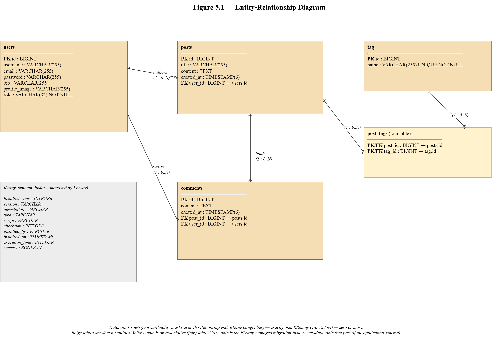

# 5. Database Schema Design

This chapter describes the database schema that supports the Pixels, Proses & Play platform. The schema is managed as versioned SQL under source control and is applied at application startup by Flyway. Section 5.1 covers the schema-management approach and the choice of validation over inference. Section 5.2 presents the entity-relationship diagram. Section 5.3 walks through each table, column by column, with the primary and foreign keys called out. Section 5.4 states the relationships and their cardinalities in prose and in a relationship table. Section 5.5 covers the dialect-specific variations across the three supported database vendors.

## 5.1 Approach to Schema Management

The platform does not rely on Hibernate's `ddl-auto=update` or `create` strategy. The `spring.jpa.hibernate.ddl-auto` property is set to `validate` across every profile. In `validate` mode Hibernate compares the mapped entities against the live schema at startup and fails loudly if any column, type, nullability, or table name is missing or mismatched. The schema itself is owned by Flyway, which reads versioned SQL migrations from the classpath, computes their checksums, and applies them to the target database in filename order, recording each applied migration in the `flyway_schema_history` table so that later runs skip migrations that have already been applied.

The pattern decouples two concerns that `ddl-auto=update` conflates. The first concern is the authoritative description of the schema: in the Flyway pattern this is the versioned SQL under `src/main/resources/db/migration/{vendor}`, which can be read, reviewed, and version-controlled like any other code artifact. The second concern is schema modification: in the Flyway pattern this is explicit, numbered, and checksum-protected, so that two developers cannot accidentally produce divergent schemas by making different changes to the same entity in parallel branches. The `ddl-auto=update` alternative silently issues `ALTER TABLE` statements inferred from bytecode, which is convenient in prototypes and dangerous in production.

Flyway is configured through a single property in `application.properties`:

```
spring.flyway.locations=classpath:db/migration/{vendor}
```

The `{vendor}` placeholder is replaced at startup by Flyway with the detected database type: `h2` on the local development profile, `mysql` under the legacy MySQL profile, or `postgresql` under the production profile that targets Neon. Each vendor's migration directory holds a complete, standalone migration history in that vendor's native SQL dialect. The three `V1__init.sql` files that currently populate the three directories produce the same logical schema through vendor-idiomatic syntax (`ENUM` on H2 and MySQL, `VARCHAR` plus `CHECK` on PostgreSQL; `AUTO_INCREMENT` on MySQL, `GENERATED BY DEFAULT AS IDENTITY` elsewhere; and `ENGINE=InnoDB` on MySQL for foreign-key support).

The decision to accept a small amount of per-vendor duplication, rather than to force a lowest-common-denominator SQL, is explicit. A shared migration constrained to pure ANSI SQL would be shorter but would require reviewers to mentally translate standard syntax into the idioms each vendor actually prefers, and would forbid features (`ENUM` types, storage engines) that are legitimate parts of their vendors' type systems. Three parallel migrations keep each file reviewable as the migration a database administrator for that vendor would write by hand.

## 5.2 Entity-Relationship Diagram

Figure 5.1 presents the entity-relationship diagram. Rectangles are tables; connecting lines represent foreign-key relationships with cardinality marks at each end in the crow's-foot style. The `post_tags` associative table is drawn explicitly because the many-to-many relationship between `posts` and `tag` is physical, not derived, and the join table carries its own primary-key constraint.



*Figure 5.1: Entity-relationship diagram of the Pixels, Proses & Play database schema.*

The diagram shows five user-defined tables plus the Flyway-managed `flyway_schema_history` metadata table. The five tables map one-to-one onto four JPA entities (`User`, `Post`, `Comment`, `Tag`) and one associative table (`post_tags`) that materializes the many-to-many relationship between posts and tags. There are no inheritance hierarchies, no polymorphic associations, and no soft-delete columns; every row deletion is a physical delete.

## 5.3 Table Definitions

This section walks through each table in the schema. For each table, the column list, the primary key, the foreign-key constraints, and the per-column nullability and uniqueness rules are stated. The DDL quoted in each subsection is the PostgreSQL variant; vendor-specific differences are summarized in Section 5.5.

### 5.3.1 users

The `users` table holds one row per registered account. The row carries the account's credentials, display attributes, and role.

```sql
CREATE TABLE users (
    id             BIGINT GENERATED BY DEFAULT AS IDENTITY PRIMARY KEY,
    username       VARCHAR(255),
    email          VARCHAR(255),
    password       VARCHAR(255),
    bio            VARCHAR(255),
    profile_image  VARCHAR(255),
    role           VARCHAR(32) NOT NULL CHECK (role IN ('ROLE_ADMIN', 'ROLE_USER'))
);
```

Column notes. The `id` column is the surrogate primary key, generated by the database's identity column. The `username`, `email`, and `password` columns are declared `VARCHAR(255)`; uniqueness and non-nullability are enforced at the entity level through the `@Column(unique = true, nullable = false)` and Jakarta Validation annotations rather than through schema-level constraints, so the Flyway migration carries the physical column shape and the application layer carries the integrity contract. The `bio` column holds the author's biography as plain text, capped at two hundred and fifty-five characters at the schema level and at five hundred characters at the form-validation level (the shorter schema cap is a conservative baseline and is a candidate for widening in a future migration). The `profile_image` column holds the URL path written by `StorageService.store` or null for an unset profile image. The `role` column is declared `VARCHAR(32)` and carries an inline `CHECK` constraint restricting the value to one of the two role strings; on H2 and MySQL the column is declared as a native `ENUM` type instead, which is covered in Section 5.5.

Primary key. `id`.

Foreign keys. None.

Referenced by. `posts.user_id`, `comments.user_id`.

### 5.3.2 posts

The `posts` table holds one row per published post. The row carries the title, the sanitized rich-text body, the creation timestamp, and a foreign-key reference to the author.

```sql
CREATE TABLE posts (
    id          BIGINT GENERATED BY DEFAULT AS IDENTITY PRIMARY KEY,
    title       VARCHAR(255),
    content     TEXT,
    created_at  TIMESTAMP(6),
    user_id     BIGINT,
    CONSTRAINT fk_posts_user FOREIGN KEY (user_id) REFERENCES users (id)
);
```

Column notes. The `id` column is the surrogate primary key. The `title` column is declared `VARCHAR(255)` and is further capped at two hundred characters at the form-validation layer. The `content` column is declared `TEXT` on all three supported vendors; the `TEXT` type is deliberately unbounded on PostgreSQL and on H2, and accepts up to sixty-five kilobytes on MySQL by default with LONGTEXT available for larger payloads. The `TEXT` choice was reached after a Phase 7 Slice 1 investigation, when an earlier `@Lob String content` entity mapping was found to be translated by Hibernate into a `pg_largeobject` column on PostgreSQL (the `oid` type) rather than the intended `TEXT` column, breaking rendering. The fix removed the `@Lob` annotation and replaced it with `@Column(columnDefinition = "TEXT")`, aligning all three vendor migrations on `TEXT`. The `created_at` column holds the publication timestamp with microsecond precision. The `user_id` column holds the foreign-key reference to the author; a null value indicates an orphaned post, which the application layer prevents.

Primary key. `id`.

Foreign keys. `fk_posts_user` on `user_id` references `users(id)`.

Referenced by. `comments.post_id`, `post_tags.post_id`.

### 5.3.3 comments

The `comments` table holds one row per comment on a post. The row carries the comment text, the creation timestamp, the parent post, and the author.

```sql
CREATE TABLE comments (
    id          BIGINT GENERATED BY DEFAULT AS IDENTITY PRIMARY KEY,
    content     TEXT,
    created_at  TIMESTAMP(6),
    post_id     BIGINT,
    user_id     BIGINT,
    CONSTRAINT fk_comments_post FOREIGN KEY (post_id) REFERENCES posts (id),
    CONSTRAINT fk_comments_user FOREIGN KEY (user_id) REFERENCES users (id)
);
```

Column notes. The `id` column is the surrogate primary key. The `content` column is declared `TEXT` across all vendors. The table name is `comments` rather than the singular `comment` because `comment` is a reserved word on PostgreSQL; the Java entity carries an explicit `@Table(name = "comments")` annotation to match. The `created_at` column holds the comment timestamp with microsecond precision. The `post_id` and `user_id` columns reference the parent post and the author.

Primary key. `id`.

Foreign keys. `fk_comments_post` on `post_id` references `posts(id)`; `fk_comments_user` on `user_id` references `users(id)`.

Referenced by. None.

### 5.3.4 tag

The `tag` table holds one row per topical tag that posts can be associated with. Tag names are stored in the case-folded form that `TagService.resolveOrCreate` produces.

```sql
CREATE TABLE tag (
    id    BIGINT GENERATED BY DEFAULT AS IDENTITY PRIMARY KEY,
    name  VARCHAR(255) NOT NULL UNIQUE
);
```

Column notes. The `id` column is the surrogate primary key. The `name` column holds the case-folded tag name, is declared `NOT NULL`, and carries a `UNIQUE` constraint that enforces the one-row-per-tag invariant at the database layer. The application-level contract is that the service layer lower-cases and trims the submitted token before issuing an insert; the `UNIQUE` constraint is the backstop that rejects the insert if two concurrent transactions race through the lookup step and both believe no such tag exists.

Primary key. `id`.

Foreign keys. None.

Referenced by. `post_tags.tag_id`.

### 5.3.5 post_tags

The `post_tags` table is the associative table that materializes the many-to-many relationship between `posts` and `tag`. The table carries no attributes of its own beyond the two foreign keys; it is a pure link table.

```sql
CREATE TABLE post_tags (
    post_id  BIGINT NOT NULL,
    tag_id   BIGINT NOT NULL,
    PRIMARY KEY (post_id, tag_id),
    CONSTRAINT fk_post_tags_post FOREIGN KEY (post_id) REFERENCES posts (id),
    CONSTRAINT fk_post_tags_tag  FOREIGN KEY (tag_id)  REFERENCES tag   (id)
);
```

Column notes. The primary key is the composite of `post_id` and `tag_id`, which makes the pair the uniqueness constraint for the relationship and prevents a given post from being attached to the same tag more than once. Both columns are declared `NOT NULL`; a relationship row with either side missing would be meaningless and the schema-level constraint rules it out.

Primary key. `(post_id, tag_id)` composite.

Foreign keys. `fk_post_tags_post` on `post_id` references `posts(id)`; `fk_post_tags_tag` on `tag_id` references `tag(id)`.

Referenced by. None.

### 5.3.6 flyway_schema_history

The `flyway_schema_history` table is managed by Flyway itself and is not part of the application's domain schema. Flyway creates the table on first run if it is missing and writes one row to it for each migration applied. The table records the migration's version string, description, checksum, success flag, and installation timestamp, which together allow Flyway to compute on a later start-up which migrations are already installed, which are pending, and whether a previously applied migration file has been edited in a way that would invalidate its history.

The table is listed here for completeness. Its schema is not reproduced because it is defined by the Flyway library and is subject to change across Flyway versions; the application's code does not read it directly.

## 5.4 Relationships and Cardinalities

The schema holds four explicit relationships plus the one that `post_tags` materializes. Table 5.01 summarizes each relationship, its cardinality at each end, the column that carries the foreign key, and the on-delete behavior.

**Table 5.01: Relationships in the Pixels, Proses & Play schema.**

| Relationship | Cardinality (parent : child) | Foreign-key column | On delete |
|---|---|---|---|
| `users` 1 → N `posts` | 1 : 0..N | `posts.user_id` | Application-level cascade through the JPA entity (`@OneToMany(cascade = REMOVE)` on `User.posts`) |
| `users` 1 → N `comments` | 1 : 0..N | `comments.user_id` | Application-level cascade through the JPA entity (`@OneToMany(cascade = REMOVE)` on `User.comments`) |
| `posts` 1 → N `comments` | 1 : 0..N | `comments.post_id` | Application-level cascade through the JPA entity |
| `posts` N ↔ M `tag` | 0..N : 0..M | `post_tags.post_id`, `post_tags.tag_id` | Join-row removal through the entity's `@ManyToMany` collection mutation |

Cascade behavior is declared at the entity level through JPA's `@OneToMany(cascade = REMOVE)` and `orphanRemoval` attributes, not at the schema level through SQL `ON DELETE CASCADE`. The decision keeps the cascade semantics visible to the application and readable in the entity code, and avoids the surprise of a schema-level cascade firing for a direct SQL statement that bypasses the application layer. The trade-off is that a bulk SQL delete on `users` from a database console would fail on the foreign-key constraint, which is the intended behavior.

All foreign keys are declared with explicit constraint names (`fk_posts_user`, `fk_comments_post`, `fk_comments_user`, `fk_post_tags_post`, `fk_post_tags_tag`) rather than left to the database to auto-name. Named constraints survive migrations without accidental rename-and-recreate cycles and are easier to reference in operational SQL.

The `users` table carries two referenced-by edges. A real-world consequence of the chosen cascade mode is that deleting a user is a composite operation that must first delete the user's comments and posts in service-layer order, and must do so within a single transaction so that a partial failure leaves no orphan rows. `AdminService.deleteUser` performs this orchestration.

## 5.5 Dialect-Specific Variations

The three vendor migration files produce the same logical schema through different SQL dialects. Table 5.02 lists each divergence between the three files, the reason for the divergence, and the strategy used to reconcile the mapped Java entity with all three physical shapes.

**Table 5.02: Dialect-specific variations across vendor migrations.**

| Concern | PostgreSQL | H2 | MySQL | Reconciliation |
|---|---|---|---|---|
| Identity column | `BIGINT GENERATED BY DEFAULT AS IDENTITY` | `BIGINT GENERATED BY DEFAULT AS IDENTITY` | `BIGINT NOT NULL AUTO_INCREMENT` | Hibernate's `GenerationType.IDENTITY` strategy on the entity's `id` field picks the vendor's own identity syntax at insert time |
| `users.role` storage | `VARCHAR(32) NOT NULL CHECK (role IN (…))` | `ENUM('ROLE_ADMIN','ROLE_USER') NOT NULL` | `ENUM('ROLE_ADMIN','ROLE_USER') NOT NULL` | The entity uses `@Enumerated(EnumType.STRING)` on a Java `Role` enum field; Hibernate serializes the enum to the string value, which both the `VARCHAR + CHECK` and `ENUM` forms accept |
| Rich-text column (`posts.content`, `comments.content`) | `TEXT` (unbounded) | `TEXT` (equivalent to CLOB internally) | `TEXT` (approximately sixty-five kilobytes) | The entity carries `@Column(columnDefinition = "TEXT")`; `@Lob` was explicitly removed because its PostgreSQL mapping is `pg_largeobject` rather than `TEXT` |
| Storage engine | n/a (PostgreSQL does not have per-table engines) | n/a | `ENGINE=InnoDB` declared per table | MySQL's InnoDB is the only engine that supports foreign keys; the migration states it explicitly to avoid a default-engine regression |
| Timestamp precision | `TIMESTAMP(6)` | `TIMESTAMP(6)` | `TIMESTAMP(6) NULL` (explicit nullable) | The entity's `LocalDateTime` field maps to all three; MySQL's explicit `NULL` compensates for its historical default of `NOT NULL DEFAULT CURRENT_TIMESTAMP` on the first timestamp column in a table |
| Table name case | lower-case | lower-case (case-insensitive by default) | lower-case (on default `lower_case_table_names=1` on Linux) | Mixed-case table names are avoided throughout to prevent a cross-platform regression |

The `comments.content` column was described in Phase 7 Slice 1's investigation as the single highest-value smoke-test catch of the project. H2's MySQL compatibility mode (`MODE=MySQL`) had silently accepted the Hibernate-generated `BLOB`-flavored mapping that the `@Lob String content` entity field produced; the Phase 7 docker-compose boot against a real PostgreSQL immediately refused the generated DDL. The lesson is captured in Section 7's deployment discussion: portability claims are only verified against the specific vendors that were run, and one happy vendor is not evidence for another.

Beyond the five differences in Table 5.02, the three files are structurally identical. The table order, the column order, the constraint names, and the foreign-key direction all match across the vendors. A reviewer who has read any one of the files can read the other two without disorientation, which is the practical test for a successful cross-vendor migration policy.
