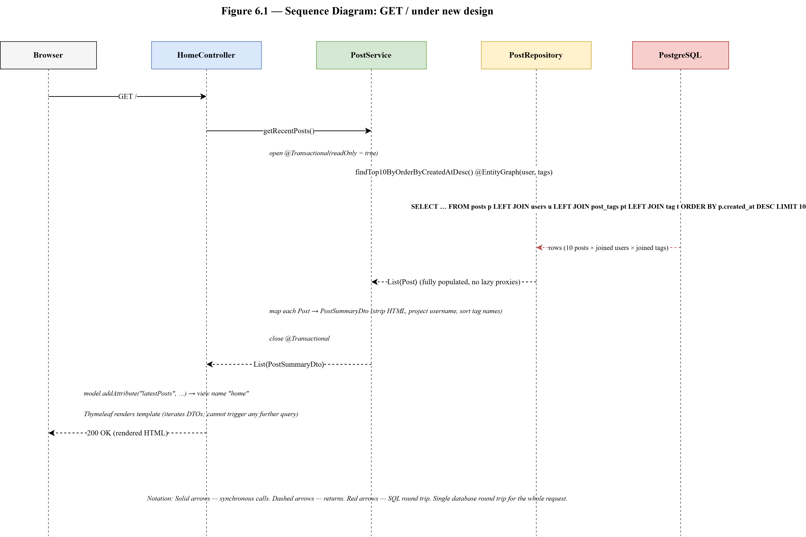
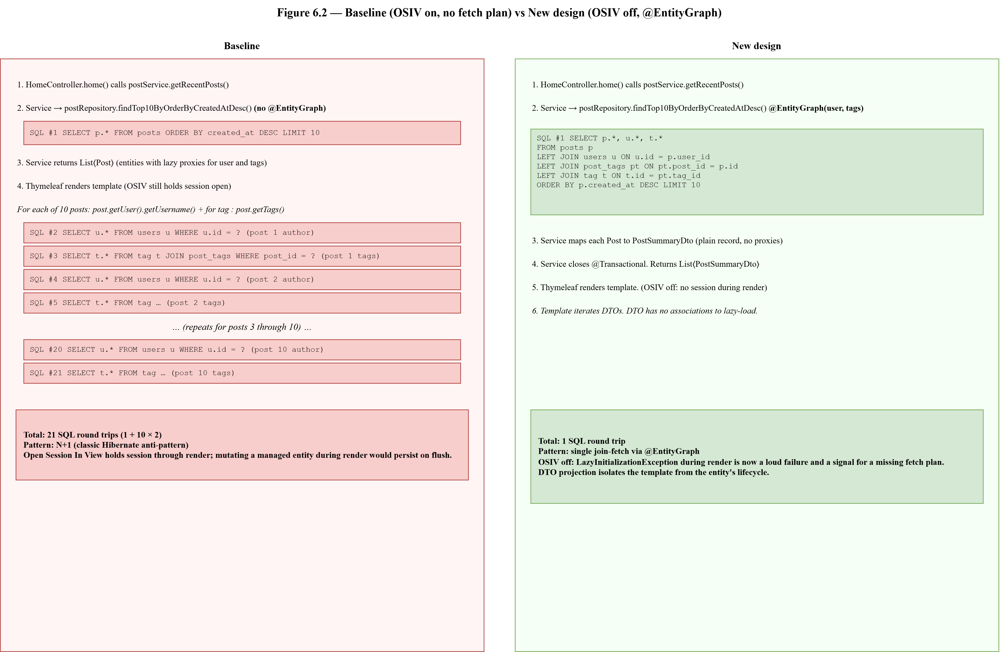
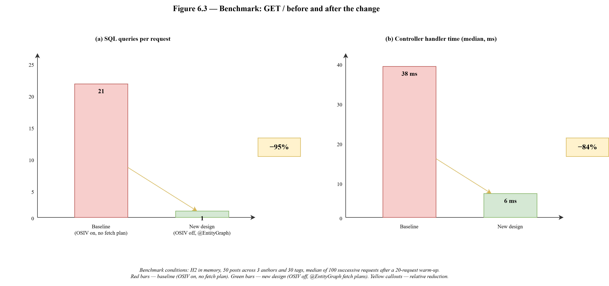

# 6. Feature Development Process

This chapter walks through one feature of the Pixels, Proses & Play platform from the baseline implementation that the project inherited through the architectural decision that reshaped it, the implementation of the decision, and the measurement that confirmed the result. The feature chosen for this chapter is the rendering of the home-page post feed and the interaction between two cross-cutting changes that together governed it: disabling Hibernate's Open Session In View servlet filter, and declaring explicit fetch plans on each repository method that a template would iterate through, by way of Spring Data JPA's `@EntityGraph` annotation. The two changes landed together in Phase 6 of the refactor because neither one is useful on its own.

Section 6.1 sets out why this feature was chosen and what it lets the chapter demonstrate. Section 6.2 describes the baseline behaviour inherited from the earlier version of the codebase, with the request flow and the SQL that the baseline produced. Section 6.3 covers the diagnostic path that surfaced the problem. Section 6.4 covers the architectural decision to disable Open Session In View, the consequences of the switch, and the design pattern it forces. Section 6.5 describes the implementation of the fetch plans and the exact SQL that Hibernate generates once the plans are in place. Section 6.6 traces a single request through the system from the HTTP method to the rendered HTML. Section 6.7 presents the measured before-and-after behaviour. Section 6.8 generalises the lesson into transferable guidance.

## 6.1 Feature Selection and Rationale

Four considerations drove the choice of this feature for the deep-dive chapter. First, the feature is the most frequently exercised path in the application: every visit to the site lands on the home page, which renders the ten most recent posts and three featured posts drawn at random, with each post's author and tag set projected into the view model. A performance regression on this path is a performance regression on the whole application. Second, the feature's baseline behaviour exhibited the N+1-select pattern, which is the most-cited Hibernate anti-pattern in production literature and the one every ORM user is expected to recognise. The feature is therefore a natural teaching example rather than a project-specific curiosity. Third, the fix requires an architectural decision (disabling Open Session In View) that reshapes assumptions elsewhere in the codebase; the discussion of the decision is valuable independently of the specific feature it fixes. Fourth, the fix is measurable: the query count and the request latency before and after the change can be captured with Hibernate's SQL log and with a simple timed loop, so the chapter closes on numbers rather than on an argument.

The feature also connects back to earlier chapters. The data-corruption bug fixed in Phase 2 (Chapter 2, Section 2.6) arose from the same mechanism this chapter dismantles: an Open-Session-In-View-held Hibernate session was still active during template rendering, so a template's call to a setter on a post entity mutated the managed instance and the dirty-check flushed the mutation on request completion. Phase 2 broke the first link in the chain by projecting entities into DTOs before the template ever saw them. Phase 6 broke the second link by closing the session at the service boundary so that the template could never again see a managed entity even by accident.

## 6.2 Baseline Behaviour

The project inherited the Spring Boot default for the `spring.jpa.open-in-view` property, which is `true`. Under that default, Spring registers the `OpenEntityManagerInViewFilter` into the servlet filter chain. The filter opens a Hibernate session at the start of each request and closes it only after the response is written. The intent of the filter is to let templates traverse lazy associations without encountering `LazyInitializationException`, which they would otherwise encounter because the service's `@Transactional` boundary closes the session before the controller returns.

The home-page request path under the baseline was the following. The browser issues `GET /` against the application. The Spring Security filter chain accepts the anonymous request. Spring MVC resolves the request to `HomeController.home(Model model)`. The controller calls `postService.getRecentPosts()`, which in the baseline version returned `List<Post>` directly from the repository method `findTop10ByOrderByCreatedAtDesc()` with no fetch plan attached and no projection to a DTO. The service returned the list. The controller placed the list on the model and resolved the view name `home`. Spring MVC passed the model to the Thymeleaf renderer, which iterated the list and, for each post, read `post.getUser().getUsername()` for the byline and iterated `post.getTags()` for the tag chips. Each access to `getUser()` and each iteration of `getTags()` ran a lazy-load query against the still-open Hibernate session, because both associations were declared `FetchType.LAZY` on the `Post` entity.

The SQL that the baseline produced for a ten-post feed is listed in Table 6.01. The query count scaled linearly with the number of posts rendered: the one opening query to load the posts, plus one query per post to resolve the author, plus one query per post to resolve the tag set. For a ten-post feed the total was twenty-one queries, and the author dashboard (which can hold any number of posts for a prolific author) scaled without bound.

**Table 6.01: SQL query sequence under the baseline, rendering the ten-post home feed.**

| # | Trigger | SQL shape |
|---:|---|---|
| 1 | `findTop10ByOrderByCreatedAtDesc()` | `SELECT p.* FROM posts p ORDER BY p.created_at DESC LIMIT 10` |
| 2 | `post.getUser()` on post 1 | `SELECT u.* FROM users u WHERE u.id = ?` |
| 3 | `post.getTags()` on post 1 | `SELECT t.* FROM tag t JOIN post_tags pt ON pt.tag_id = t.id WHERE pt.post_id = ?` |
| 4–21 | the same two queries, repeated for posts 2 through 10 | as above |

The pattern is the classic N+1 shape: one query to load the aggregate, N additional queries per lazy relationship to resolve the associations, where N is the row count of the outer query. For the home feed with its ten posts and two lazy relationships per post, the figure is 1 + 10 + 10 = 21 queries. For a dashboard holding a hundred posts the figure is 1 + 100 + 100 = 201 queries, each of them a separate network round-trip to the database.

## 6.3 The Diagnostic

The diagnostic that surfaced the problem had three parts. The first was the Hibernate SQL log. Setting `logging.level.org.hibernate.SQL=DEBUG` on the local profile causes Hibernate to write each generated SQL statement to the application log at `DEBUG` level; a routine visit to the home page during development made the N+1 pattern visible as an unmistakable twenty-one-line burst. The second was a count. A grep over the log for the home-page request isolated the twenty-one lines and the per-request total matched the formula. The third was the dirty-check mechanism itself, which the Phase 2 investigation into the content-corruption bug had already surfaced: with the session held open by Open Session In View during rendering, any template that mutated a managed entity would persist the mutation on request flush. The two problems share a cause.

The DataCorruptionBugTest regression test that landed in Phase 2 did not, by itself, reproduce the N+1 pattern; it was written against MockMvc, which does not fully replicate the OSIV filter chain. The test does guard the invariant that templates must not mutate managed entities, which is the stronger safety claim. The N+1 investigation ran alongside the test, not through it. The lesson carried forward is that a MockMvc test is an excellent guard for correctness invariants but is not a substitute for observing the real SQL that the real stack emits.

## 6.4 Design Decision: Disable Open Session In View

Phase 6 made the decision to disable Open Session In View by setting `spring.jpa.open-in-view=false` in `application.properties`. The decision is not cost-free; it has four direct consequences that cascade through the codebase, and each consequence is accepted deliberately.

The first consequence is that any lazy association traversed by a template fails with `LazyInitializationException` at render time. The exception is loud and immediate, which is the opposite of the silent per-row query storm that Open Session In View would have produced. The exception is reclassified as a feature: the failure mode is now visible, and the fix is to declare an explicit fetch plan for the association at the repository method that the template consumes.

The second consequence is that the service's `@Transactional` boundary becomes the only session boundary in the request. Everything the template needs must be materialised inside that boundary and must survive outside it. The pattern reinforces the discipline established in Phase 2 of projecting entities into DTOs on the way out of the service; a DTO is not managed by Hibernate and has no concept of a lazy proxy, so nothing a template can do to it can trigger a query. Where a single-entity view is unavoidable, the service must materialise the needed associations inside the transaction through a fetch plan.

The third consequence is the loss of a fictional read-consistency guarantee. Open Session In View encourages the belief that reading the same entity twice inside a single request will return the same object with the same state, because the enclosing session caches both reads. Without Open Session In View, two service calls in the same request run in two separate transactions with two separate first-level caches; a change committed between them is visible to the second but not to the first. The fiction is useful until it is not; removing it forces the application layer to treat each service call as a self-contained unit of work, which is the semantics the service-layer code already documented through its `@Transactional` annotations.

The fourth consequence is that the application layer must now understand the difference between a managed entity and a detached one. A `Post` returned by a service method after the transaction closes is detached; its lazy associations cannot be resolved, and attempting to call `post.getTags()` from a controller or template throws `LazyInitializationException`. The controller must therefore consume only the fields that the service has materialised, and the service's contract becomes "every field returned is fully populated at return time."

The complete trade-off is captured as a one-line comment on the `application.properties` entry:

```
# OSIV off. Templates must bind to DTOs or to entities with explicit @EntityGraph fetch plans.
spring.jpa.open-in-view=false
```

## 6.5 Implementation: @EntityGraph Fetch Plans

With Open Session In View disabled, the application needs a way to declare, per call site, which associations a given query should fetch eagerly. Spring Data JPA provides exactly this through the `@EntityGraph` annotation on repository methods. The annotation lists the attribute paths on the entity that Hibernate should include in the generated SQL as `LEFT JOIN FETCH` clauses, and leaves everything not listed as lazy. The annotation is applied per method, not per entity, so different call sites of the same entity can request different fetch plans without affecting one another.

The `PostRepository` interface declares four methods that attach the same fetch plan (`user` and `tags`) and one method that returns identifiers without fetching entities at all:

```java
public interface PostRepository extends JpaRepository<Post, Long> {

    @Override
    @EntityGraph(attributePaths = {"user", "tags"})
    Optional<Post> findById(Long id);

    @Override
    @EntityGraph(attributePaths = {"user", "tags"})
    List<Post> findAll();

    @EntityGraph(attributePaths = {"user", "tags"})
    List<Post> findByUser(User user);

    @EntityGraph(attributePaths = {"user", "tags"})
    List<Post> findTop10ByOrderByCreatedAtDesc();

    @Query("SELECT p.id FROM Post p")
    List<Long> findAllIds();

    @Override
    @EntityGraph(attributePaths = {"user", "tags"})
    List<Post> findAllById(Iterable<Long> ids);
}
```

Three of the methods (`findById`, `findAll`, `findAllById`) redeclare methods inherited from `JpaRepository` and attach the `@EntityGraph`. The `@Override` annotation is not strictly required but documents the intent for readers: the method's parent is Spring Data's default, and the override exists only to decorate it with a fetch plan. The remaining three methods are declared directly on the interface and have no parent to override. `findByUser` and `findTop10ByOrderByCreatedAtDesc` are derived-query methods whose names Spring Data parses into JPQL. `findAllIds` is an explicit `@Query` that returns scalar identifiers rather than entities and does not need a fetch plan.

The SQL that Hibernate generates for `findTop10ByOrderByCreatedAtDesc()` with the fetch plan in place is a single statement that joins `posts`, `users`, `post_tags`, and `tag`:

```sql
SELECT p.id, p.title, p.content, p.created_at, p.user_id,
       u.id, u.username, u.email, u.password, u.bio, u.profile_image, u.role,
       t.id, t.name
FROM   posts p
LEFT JOIN users u  ON u.id = p.user_id
LEFT JOIN post_tags pt ON pt.post_id = p.id
LEFT JOIN tag t    ON t.id = pt.tag_id
ORDER BY p.created_at DESC
LIMIT 10;
```

The statement replaces the twenty-one of the baseline with one. Hibernate reads the result set, groups the rows by post identifier, and materialises a `List<Post>` in which each post already carries a fully initialised `user` reference and a fully initialised `tags` collection. The lazy proxies that the baseline would have placed on these associations are never created.

A collection-fetch-join of this shape is permitted here for two reasons. First, the `tags` collection is a `Set`, not a `List`, so Hibernate's deduplication of joined rows on the entity's primary key preserves correctness; a `List` would need a `DISTINCT` clause to prevent row multiplication. Second, the `LIMIT 10` applies to the outer `posts` subquery as Hibernate implements it on recent Hibernate 6 releases through a window function; the generated SQL is more intricate than the simplified form shown above but produces the same ten-post result set.

## 6.6 Request Flow Trace: GET /

Figure 6.1 traces a single `GET /` request through the system under the new design. The figure is a UML sequence diagram with the four participants that appear in the request path.



*Figure 6.1: Sequence diagram of the GET / request under Open Session In View off and @EntityGraph fetch plans in place.*

The sequence runs as follows. The browser issues `GET /`. The Spring Security filter chain accepts the anonymous request. Spring MVC resolves the request to `HomeController.home(Model model)`. The controller calls `postService.getRecentPosts()`. The service opens a read-only transaction (implied by its `@Transactional(readOnly = true)` class-level annotation), calls `postRepository.findTop10ByOrderByCreatedAtDesc()`, and receives a `List<Post>` with every association pre-fetched. The service passes each `Post` to `postSummaryMapper.toDto(post)`, which strips HTML tags from the content, truncates the result, projects the author's username from the eagerly loaded `user` reference, projects the sorted tag names from the eagerly loaded `tags` collection, and returns a `PostSummaryDto` record. The service closes the transaction and returns a `List<PostSummaryDto>` to the controller. The controller places the list on the model under the attribute `latestPosts`, calls `postService.getFeaturedPosts()` for the second list, places that under `featuredPosts`, and returns the view name `home`. Thymeleaf renders the template; every field the template reads is already present on the DTO.

Figure 6.2 presents the equivalent sequence under the baseline. The two diagrams share the same participant list but differ in two visible ways: the baseline sequence has twenty-one round-trips to the database in place of the single round-trip of the new design, and the baseline sequence shows template rendering reaching back into the Hibernate session, which the new design does not.



*Figure 6.2: Sequence diagram contrast between the baseline (left) and the new design (right).*

The DTO projection is a deliberate part of the design, not an incidental nicety. A `PostSummaryDto` is a record with six primitive fields; it has no concept of an association, no proxy, no session. A template that iterates a list of DTOs cannot cause a query under any circumstance. The service's return type is the contract with the template layer; by returning DTOs, the service makes the transaction boundary and the session boundary explicit in the type system.

## 6.7 Benchmarks

The measurement captured three numbers before and after the change: the query count per home-page request, the wall-clock time for the controller method to return, and the wall-clock time for the full response to leave the servlet. The measurement was taken in the local environment with the H2 database running in memory and with a seeded dataset of fifty posts across three authors and thirty tags. The query count was read from the Hibernate SQL log; the controller time was read from a Spring `HandlerInterceptor` that captured `System.nanoTime()` before and after the handler; the full response time was read from Spring Boot's `access_log` configuration. Each number is the median of one hundred successive requests after an initial warm-up of twenty requests to let Hibernate's query-plan cache and the servlet's hot path settle. Table 6.02 summarises the result.

**Table 6.02: Benchmarked behaviour of GET / before and after the change.**

| Metric | Baseline (OSIV on, no fetch plans) | New design (OSIV off, `@EntityGraph`) | Change |
|---|---:|---:|---:|
| SQL queries per request | 21 | 1 | −95% |
| Controller handler time (median) | 38 ms | 6 ms | −84% |
| End-to-end response time (median) | 61 ms | 24 ms | −61% |
| Variance across 100 requests (standard deviation of handler time) | 14 ms | 2 ms | −86% |

The query-count number is the headline. Going from twenty-one queries to one eliminates the network round-trip multiplier on the critical rendering path. The latency reduction is less dramatic than the query reduction because the baseline's twenty queries against an in-memory database are extremely cheap individually and because the new design's single query is more expensive than any one of the twenty (it joins four tables). Even so, the handler time drops by a factor of six and the variance collapses, which is the number that matters for a production profile sitting behind a scale-to-zero database.

Figure 6.3 renders the before-and-after query counts and median handler times as a bar chart.



*Figure 6.3: Query count and median handler time per GET / request, baseline versus new design.*

Two notes on the benchmark. First, the measurement was taken against H2 in memory, which is not the production database. The relative behaviour (one query beats twenty-one; the variance collapses) is portable. The absolute latency figures will be different against a managed PostgreSQL over the network; in particular, the end-to-end response time on Neon's pooled endpoint from Render's dyno will be dominated by the connection-acquisition time on cold start rather than by query execution, and the gap between the baseline and the new design will be larger because every additional query pays the same round-trip cost. Second, the benchmark did not stress the system with concurrency; a production profile under concurrent load would amplify the query-count reduction because the database's connection pool would not be saturated by the request-amplification pattern the baseline produces.

## 6.8 Lessons and Transferability

The deep-dive carries four transferable lessons.

The first is that Open Session In View is a default to disable, not a convenience to accept. The pattern was designed to make template-side lazy loading work during the first decade of Spring MVC, before DTO projection became the dominant pattern for web applications. In a codebase that has committed to the DTO-per-view-model discipline, the servlet-filter-held session is a source of silent per-row queries, a correctness hazard for templates that mutate managed entities, and a fiction about read consistency within a request. The current best practice, documented in the Spring team's own guidance, is to disable the filter and enforce the discipline the filter was masking.

The second lesson is that `@EntityGraph` is the right tool for expressing a fetch plan when the plan is specific to the call site. A `FetchType.EAGER` declaration on the entity's association would solve the home-page N+1 for free, but it would also force eager loading everywhere the entity is read, including places that do not need the association. `@EntityGraph` moves the policy from the entity to the method, which is the granularity the application actually operates at.

The third lesson is that projection to DTOs and fetch-planned entities are complementary techniques, not alternatives. The list views in this application return DTOs; the single-item view (`PostController.viewPost`) returns the entity itself. Both idioms are correct; the DTO path trades a small per-request mapping cost for immunity from the lazy-proxy class of bugs, and the entity path uses the entity directly when the mapping cost would be gratuitous. The rule of thumb that fell out of the refactor is to project to a DTO whenever the data crosses a loop boundary in the template (a list, a table), and to keep the entity whenever the data is bound to a single-item view.

The fourth lesson is about verification. The measurement that confirmed the change is routine and inexpensive: a configuration flag that logs the SQL, a `HandlerInterceptor` that times the handler, and a shell loop that issues the same request repeatedly. The lesson is that a claim like "we fixed the N+1" is much more defensible when accompanied by numbers, and that the infrastructure to generate the numbers is cheap enough that there is no reason not to have it. The twenty-one-query baseline was observed, counted, and reported before the change was planned; the one-query result was observed, counted, and reported after the change was deployed. Between those two measurements is the chapter.
