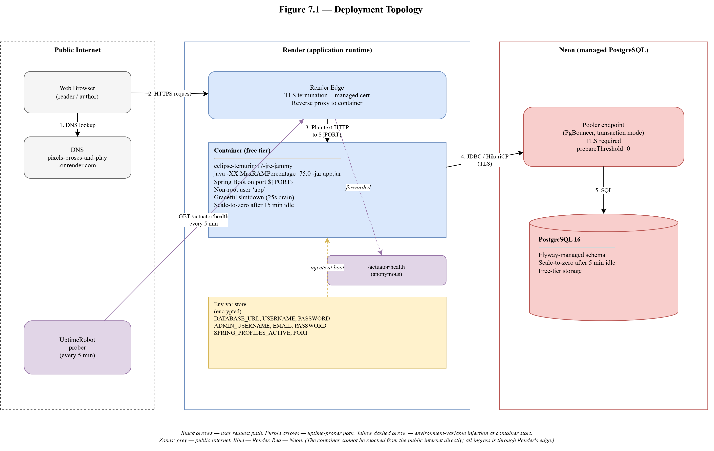
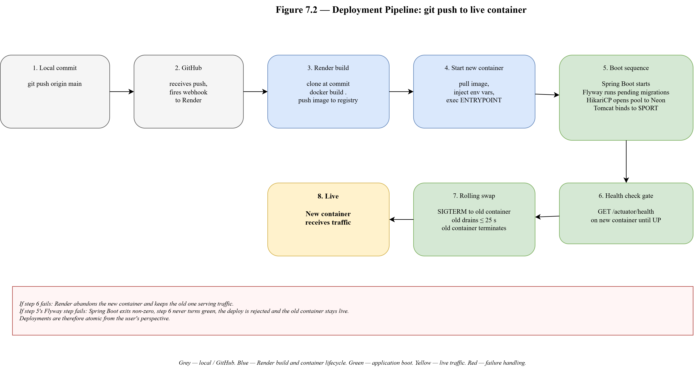

# 7. Deployment Flow

This chapter describes how the Pixels, Proses & Play platform is packaged, published, and operated. The chapter deviates from the template's prescriptive AWS stack in favour of a free-tier platform-as-a-service combination (Render for the application runtime, Neon for the managed PostgreSQL database, UptimeRobot for external monitoring). Section 7.1 states the deployment goals and the constraints that produced the choice of stack. Section 7.2 presents the deployment topology. Section 7.3 covers the container image and its build pipeline. Section 7.4 covers the application runtime on Render. Section 7.5 covers the database on Neon and the pooling configuration that connects the two. Section 7.6 covers secrets and runtime configuration. Section 7.7 covers observability through Spring Boot Actuator and UptimeRobot. Section 7.8 traces a single deployment from a `git push` to the running image. Section 7.9 maps the chosen components onto the template's AWS equivalents for cross-reference. Section 7.10 reviews the alternatives considered and the trade-offs accepted.

The live deployment, reachable at `https://pixels-proses-and-play.onrender.com`, runs the configuration described below.

## 7.1 Deployment Goals and Constraints

Three goals shaped the deployment decisions. First, the deployment had to be reproducible from the source repository alone, with no manual bootstrap steps. The repository holds the Dockerfile, the application configuration, and the Flyway migrations; a new deployment is a fresh container build plus a connection string, and nothing else is required to be preserved between environments. Second, the deployment had to fit within a zero-cost operating envelope, because the project is a capstone and ongoing hosting costs would retire the live site shortly after submission. Third, the deployment had to exercise the portability work landed in Phase 5, running against a real PostgreSQL rather than against the H2 in-memory database that dominated development.

The three goals together ruled out a classical self-managed deployment on a cloud virtual machine. A virtual machine requires manual configuration, incurs cost even when idle, and asks the operator to run the database themselves. They favoured a container-oriented platform-as-a-service combination that accepts an OCI image, injects secrets through environment variables, and is paired with a managed PostgreSQL provider that offers a free tier.

Among the free-tier options considered (Render, Fly.io, Railway, Koyeb), Render was selected for three reasons. Render accepts a Dockerfile directly without a provider-specific manifest. Render's free web-service tier includes managed TLS, automatic deployment on push to a watched branch, and a listener that scales the service down after fifteen minutes of inactivity (which is acceptable for a project with sparse traffic). Among the free-tier PostgreSQL providers considered (Neon, Supabase, ElephantSQL, Aiven), Neon was selected because it offers a true scale-to-zero model, a generous storage allowance on the free tier, and a connection pooler endpoint that matches the shape of the application's HikariCP configuration.

## 7.2 Deployment Topology

Figure 7.1 shows the deployment topology. The diagram has five actors: the author's browser, the public DNS record, Render's edge and container runtime, the Neon pooler and PostgreSQL instance, and the UptimeRobot prober.



*Figure 7.1: Deployment topology of the Pixels, Proses & Play live environment.*

A request path runs as follows. The browser resolves `pixels-proses-and-play.onrender.com` to Render's edge network through Render's managed DNS. Render's edge terminates TLS using a certificate it provisions and renews automatically through its managed certificate authority integration. The edge forwards the request to the single running container instance. The container runs the application image described in Section 7.3 and holds the Spring Boot process on port 8080 inside the container, which Render maps to the public port 443 at the edge. The Spring Boot process receives the request, runs its business logic, and, when a database query is required, issues the query through HikariCP's pool to the Neon pooler endpoint; the pooler forwards the query to the primary PostgreSQL instance on Neon's compute plane. The response flows back along the reverse path.

The UptimeRobot prober does not participate in the live request path. It issues one HTTP GET to `/actuator/health` every five minutes from its own infrastructure, which Render's edge forwards to the container like any other request. The prober's role is covered in Section 7.7.

## 7.3 Container Image

The application image is built from a two-stage Dockerfile at the repository root. The first stage is a builder image based on `maven:3.9-eclipse-temurin-17`; the second stage is a runtime image based on `eclipse-temurin:17-jre-jammy`. The two-stage pattern separates the artefacts needed at build time (Maven, the JDK, the full `.m2` cache, the application source) from the artefacts needed at run time (a JRE and the built jar), producing a runtime image that is substantially smaller than the builder image and that carries no build tools, no source code, and no package manager state.

The builder stage primes the dependency cache in its own layer before copying the source tree:

```dockerfile
FROM maven:3.9-eclipse-temurin-17 AS builder
WORKDIR /build
COPY pom.xml .
RUN mvn -B -q dependency:go-offline
COPY src ./src
RUN mvn -B -q clean package -DskipTests
```

The deliberate ordering is that `pom.xml` is copied before the source, so the dependency-resolution layer is cached on the content hash of `pom.xml` alone. An iteration on application code reuses the primed `.m2` cache from the previous build; only a change to `pom.xml` invalidates the cache and forces a redownload. Tests are skipped in the container build because the image is an artefact step, not a test step. The real test suite runs in the local development loop and will run in CI once CI is attached.

The runtime stage writes the built jar into a dedicated application directory, creates a non-root user to own the process, and declares the entry point:

```dockerfile
FROM eclipse-temurin:17-jre-jammy
WORKDIR /app
RUN groupadd --system app && useradd --system --gid app --home /app app \
    && mkdir -p /app/uploads \
    && chown -R app:app /app
COPY --from=builder --chown=app:app /build/target/*.jar /app/app.jar
USER app
EXPOSE 8080
ENTRYPOINT ["java", "-XX:MaxRAMPercentage=75.0", "-jar", "/app/app.jar"]
```

Three details of the runtime stage merit comment. First, the container runs as a non-root user named `app`. The convention is standard for containerised Java applications and defeats the class of attacks that assume `root` inside the container. Second, the `/app/uploads` directory exists and is owned by the `app` user; it is the single writable path the application needs, and it is a volume mount point in production where the container's writable layer is otherwise read-only to the application. Third, the entry point sets `-XX:MaxRAMPercentage=75.0`. The flag tells the JVM to use seventy-five percent of the container's memory limit as the heap ceiling. The JVM has been container-aware by default since Java 10, but the default heap ceiling is twenty-five percent of the detected memory, which is too timid for a dedicated container; on Render's five-hundred-and-twelve-megabyte free instance, seventy-five percent gives the heap approximately three hundred and eighty megabytes and leaves enough headroom for metaspace, direct buffers, and native memory. Without the flag, the JVM would try to grow the heap based on the detected host memory and the kernel would OOM-kill the container on every deploy.

The `EXPOSE 8080` directive is documentation. The container's actual listening port is governed by the `server.port` property at startup, which reads the `PORT` environment variable with a fallback of 8080. Render injects `PORT` at container start; the application binds wherever Render asks it to. The pattern is the Twelve-Factor App's port binding principle applied to a Spring Boot container.

## 7.4 Application Runtime: Render

The application runs on Render as a single web service in the free tier. The Render dashboard holds a declarative configuration pointing at the application's GitHub repository, the branch to watch (`main`), the build command (`docker build`, which Render runs implicitly because the repository has a Dockerfile), and the set of environment variables that drive the application. Render's build pipeline fires on every push to the watched branch: it clones the repository, builds the Docker image, uploads it to Render's internal registry, and triggers a rolling redeploy of the web service against the new image.

The web service configuration declares the Spring profile explicitly through an environment variable (`SPRING_PROFILES_ACTIVE=postgres`), which activates `application-postgres.properties`. The properties file layers on top of the profile-agnostic defaults in `application.properties` and overrides the datasource configuration to read its connection details from environment variables rather than from hard-coded values:

```properties
spring.datasource.url=${DATABASE_URL:jdbc:postgresql://localhost:5432/blogdb}
spring.datasource.driver-class-name=org.postgresql.Driver
spring.datasource.username=${DATABASE_USERNAME:postgres}
spring.datasource.password=${DATABASE_PASSWORD:}
```

The default values that follow the colons in the placeholders are convenience fallbacks for a local docker-compose run against a sidecar PostgreSQL container; in production on Render the three variables are always set, so the defaults are never read.

The web service listens on the port Render injects:

```properties
server.port=${PORT:8080}
```

Render's load balancer terminates TLS and reverse-proxies the plaintext request to the container on the injected port. The application is never exposed directly to the public internet; the only route in is through Render's edge. The DNS record is a `CNAME` managed by Render pointing at Render's edge hostname.

Graceful shutdown is configured so that redeploys do not drop in-flight requests:

```properties
server.shutdown=graceful
spring.lifecycle.timeout-per-shutdown-phase=25s
```

The pair instructs Spring Boot to stop accepting new connections on `SIGTERM`, to let in-flight requests finish for up to twenty-five seconds, and only then to exit the JVM. Render sends `SIGTERM` to the old container ten seconds before swapping to the new one during a redeploy; the twenty-five-second drain is comfortably within Render's grace period. Without graceful shutdown, every redeploy would send a connection reset to any user with an open request, which is the single highest-impact annoyance that the configuration removes.

Render's free tier spins the container down after fifteen minutes with no inbound traffic and spins it back up on the next request. The cold start is roughly sixty seconds, dominated by the JVM boot and by Spring's bean initialisation. The spin-down is the free-tier trade-off and is addressed through the uptime prober described in Section 7.7, which issues a request every five minutes and keeps the fifteen-minute idle timer from ever expiring.

## 7.5 Database: Neon

The database is a Neon-managed PostgreSQL instance on Neon's free tier. Neon holds the data on its own storage plane and offers two endpoint types for connections: a direct endpoint, which connects straight to the primary compute node, and a pooler endpoint, which runs PgBouncer in transaction-pooling mode in front of the compute node. The application connects to the pooler endpoint through its JDBC URL:

```
jdbc:postgresql://ep-xxxxxxx-pooler.ap-south-1.aws.neon.tech:5432/blogdb?sslmode=require&prepareThreshold=0
```

The URL carries three features that are worth calling out. First, the hostname contains the `-pooler` suffix, which selects the pooled endpoint over the direct endpoint. Second, `sslmode=require` enforces TLS on the connection; Neon does not accept plaintext connections on any endpoint. Third, `prepareThreshold=0` disables server-side prepared statements in the JDBC driver. The parameter is non-optional with a pooler and is the single hardest-earned configuration insight from the deployment phase.

The reason `prepareThreshold=0` is required deserves a paragraph. PgBouncer in transaction-pooling mode reuses a backend connection per database transaction, not per client session. A client that opens a connection, begins a transaction, runs a statement, commits, and runs another statement is holding two different backend connections across the pair; a server-side prepared statement registered on the first backend is unknown to the second. The PgJDBC driver's default behaviour is to cache prepared statements client-side after five executions and reuse them by handle on subsequent executions, which fails with a cryptic `prepared statement "S_1" does not exist` the first time the pooler routes the reuse to a different backend. Setting `prepareThreshold=0` disables the client-side caching entirely, which costs approximately ten percent per query throughput in exchange for making the pooler usable. The same requirement applies to AWS RDS Proxy and Supabase's pooler; the mechanism is identical.

HikariCP is sized for the free-tier operating envelope and for Neon's scale-to-zero model:

```properties
spring.datasource.hikari.maximum-pool-size=5
spring.datasource.hikari.minimum-idle=0
spring.datasource.hikari.idle-timeout=240000
spring.datasource.hikari.connection-timeout=10000
```

The pool caps at five concurrent connections. The minimum-idle of zero releases every connection when traffic is quiet, which allows Neon's compute plane to scale down to zero after five idle minutes. The idle timeout of four minutes closes any connection before Neon would close it from its side (which would surface to HikariCP as a stale-connection error on the next acquire). The connection timeout of ten seconds bounds how long a thread blocks waiting for a free connection before failing fast.

The cold-start arithmetic that falls out of the configuration has three layers. Render spins the container down after fifteen minutes of no requests. Neon spins the compute plane down after five minutes of no connections. HikariCP releases its last connection after four idle minutes. On a visit after a long nap the three warm-up costs chain: Render spins the container up (approximately sixty seconds), the first database query wakes Neon (approximately three to five seconds), HikariCP opens a fresh connection (approximately one hundred milliseconds), and the request completes. The chain is the free-tier trade-off and is visible to the first user after an idle period as a one-minute first-page load. Subsequent requests in the same window are fast.

## 7.6 Secrets and Runtime Configuration

The application carries no secrets in the source repository. Every value that would otherwise be a secret is read from an environment variable at startup through Spring's property-placeholder mechanism. The production profile reads the following seven variables:

- `DATABASE_URL`, `DATABASE_USERNAME`, `DATABASE_PASSWORD` — the Neon connection details, set from Neon's console and transcribed into Render's dashboard.
- `PORT` — the port Render injects for the container to bind on.
- `ADMIN_USERNAME`, `ADMIN_EMAIL`, `ADMIN_PASSWORD` — the bootstrap administrator credentials, read at startup by the `AdminBootstrapper` component (described in Chapter 2's phased pipeline and in Chapter 4's configuration-class section). The component is active only on the `postgres` profile, so local development does not seed an administrator.

Render stores the variables in encrypted form in its own key store and injects them into the container's environment at process start. The container's `/proc/<pid>/environ` is readable only by the `app` user that runs the process, so a successful compromise of the application would see the variables but no other container on the host would. Render rotates its own encryption keys periodically; the application does not need to be aware of the rotation.

The pattern keeps every runtime secret out of version control, out of the container image, and out of any file that moves between developer machines. A new environment is provisioned by setting the seven variables and nothing else. The alternative (a `.env` file or a secrets file baked into the image) is a routine source of accidental credential leaks and is not used here.

## 7.7 Observability: Actuator and UptimeRobot

The application exposes Spring Boot Actuator with a restricted set of endpoints:

```properties
management.endpoints.web.exposure.include=health
management.endpoint.health.show-details=never
```

The exposure allowlist exposes only `/actuator/health`. The details flag hides component-level state (database connectivity, disk space, mail server) from the public response; the endpoint returns a plain `{"status":"UP"}` when the application is healthy and nothing more. Spring Security's filter chain is configured to permit anonymous access to the one endpoint.

UptimeRobot pings `/actuator/health` every five minutes from its own infrastructure and alerts on three consecutive failed probes. The monitor serves two purposes. The first is to detect genuine outages; a one-line email arrives on the author's inbox within fifteen minutes of a down event. The second is to keep the free-tier runtime warm. Render's spin-down threshold is fifteen minutes of no requests; UptimeRobot's five-minute probe interval is comfortably under that threshold, so the container is never allowed to idle into a spin-down state during normal operation.

The configuration is a deliberate inversion of the standard enterprise observability pattern, where the application reports metrics to an external collector (Prometheus, Datadog) through a push or scrape loop. The Pixels, Proses & Play deployment uses the opposite model: the application exposes one thin health endpoint, and the external prober treats the endpoint as both a liveness check and a keep-alive. The pattern fits the constraints (zero-cost, single-container, sparse-traffic) in a way that a full metrics pipeline would not.

## 7.8 Deployment Pipeline

Figure 7.2 traces a single deployment from the author's local commit to the running container image.



*Figure 7.2: Deployment pipeline from `git push` to running container.*

The sequence is as follows. The author runs `git push origin main` on the local machine. GitHub receives the push and fires a webhook that Render has registered on the repository. Render receives the webhook and enqueues a build. Render's build infrastructure clones the repository at the pushed commit, runs `docker build .` against the Dockerfile at the repository root, and uploads the resulting image to Render's internal container registry under a new tag. On a successful build, Render triggers a rolling redeploy of the web service: it starts a new container from the new image, waits for the new container's `/actuator/health` to return `UP`, sends `SIGTERM` to the old container, waits up to Render's grace period (which is longer than the application's twenty-five-second drain), and finally terminates the old container. The new container is now the live one.

Flyway runs as part of the application's own startup inside the new container, not as a separate deployment step. On the first boot after a schema change, Spring Boot's Flyway auto-configuration reads the migration directory, computes the pending migrations against the live schema history, applies them inside a transaction, and only then allows the application to accept traffic. The sequence means that a deployment is atomic from the user's perspective: either the new container boots successfully and starts serving the new schema, or it fails health checks and Render leaves the old container in place.

The deployment pipeline is intentionally thin. The repository does not carry a GitHub Actions workflow or any other CI configuration at the time of submission, because the tests run locally and the container build runs on Render. The next evolution of the pipeline would add a GitHub Actions workflow that runs the full Maven test suite on every push and only allows the Render deploy to proceed on a green CI run; the slice is small and is on the post-submission backlog.

## 7.9 Mapping to the Template's AWS Stack

The Scaler template's deployment chapter is written against an AWS stack: EC2, VPC, Security Groups, RDS, an optional cache, and Elastic Beanstalk for the orchestration. The Pixels, Proses & Play deployment uses a different concrete set of components, but every component maps onto an AWS equivalent in the template's vocabulary. Table 7.01 lays out the mapping so that a reader familiar with the AWS stack can read this chapter alongside the template without disorientation.

**Table 7.01: Mapping of Pixels, Proses & Play deployment components onto the template's AWS stack.**

| Template component (AWS) | Pixels, Proses & Play (actual) | What it provides |
|---|---|---|
| Elastic Beanstalk | Render web service | Orchestration, autoscaling (single-instance here), deploy triggering, container lifecycle |
| EC2 instance | Render container | The compute node that runs the application process |
| AMI | Dockerfile + built image | The reproducible boot artefact for the compute node |
| VPC + subnet | Render's internal network | The network boundary between the application and the public internet |
| Security Group | Render's default service exposure (only port 443 from the edge) | Ingress filtering; the container is not reachable except through Render's edge |
| Application Load Balancer + ACM certificate | Render's managed edge (TLS termination + certificate provisioning) | TLS termination, routing, managed certificates |
| RDS PostgreSQL | Neon PostgreSQL | Managed relational database |
| RDS Proxy | Neon pooler endpoint (PgBouncer, transaction pooling) | Connection pooling in front of the database |
| CloudWatch alarm + Lambda warmer | UptimeRobot ping on `/actuator/health` | External liveness probe that also keeps a scale-to-zero runtime warm |
| CloudWatch logs | Render's log viewer | Standard-output log aggregation |
| Secrets Manager | Render's environment variable store (encrypted) | Secret storage with injection at container start |

The mapping is one-to-one on every row. The components named in each row provide the same abstraction at approximately the same granularity; a reader who has operated the left column can read the right column as "the same, under different brand names" without having to update the mental model.

Two differences are worth noting explicitly. First, the template's stack assumes a Virtual Private Cloud with an explicit subnet and routing table; Render abstracts the network entirely, and the application cannot see or configure the network layer. Second, the template lists a cache tier (ElastiCache) as optional; Pixels, Proses & Play does not use a cache, both because the traffic profile does not warrant one and because the first-level Hibernate cache plus the query-level `@EntityGraph` fetch plans eliminate the hot-path query cost that a Redis cache would otherwise address.

## 7.10 Alternatives and Trade-offs

Three alternatives to the chosen stack were considered and declined, each for stated reasons.

A self-managed deployment on a free-tier cloud virtual machine (for example, Oracle Cloud's always-free ARM instance) was declined because of the operational burden. The virtual machine would require manual TLS certificate provisioning, manual OS patch management, manual PostgreSQL installation, and manual backup configuration; none of these are intrinsically interesting problems to solve for a capstone, and each is a source of potential site outages that the project is not staffed to address.

A deployment on Fly.io was considered as a direct alternative to Render. Fly.io accepts a Dockerfile, offers managed TLS, and has a comparable free tier. The project was built against Render instead because Render's dashboard-driven configuration was shorter to set up than Fly.io's `fly.toml` and `flyctl` workflow for a single-container application. The Dockerfile is identical between the two providers, so a future migration is a matter of changing the deployment target, not of rebuilding the artefact.

A deployment using Spring Boot's built-in TLS termination and a public IP on a DigitalOcean droplet was considered and declined on cost. Any configuration that requires a persistently running compute node costs money; the free-tier platform-as-a-service model turns the cost into zero at the price of accepting a cold start on resumption.

The trade-offs accepted with the chosen stack are the following. The free-tier cold start is approximately sixty seconds, which the uptime prober hides under normal operation but which the first visitor after a genuine idle period sees. The Neon free tier allows one database per project, which the application uses entirely; a hypothetical multi-environment deployment (staging plus production) would need a Neon paid tier or a second Neon account. The Render free tier allows a single web service with a restricted memory and CPU envelope, which is sufficient for the measured traffic profile but which would need to be upgraded if the user base grew by a factor of ten or more.

The deployment as submitted is, by design, the simplest configuration that runs the application in production, verifies the portability work of Phase 5, and costs nothing to operate. Every component in the stack can be replaced without rewriting any application code.
